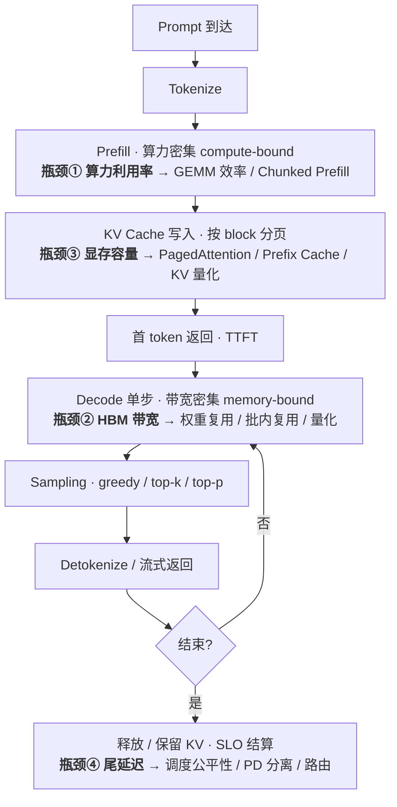
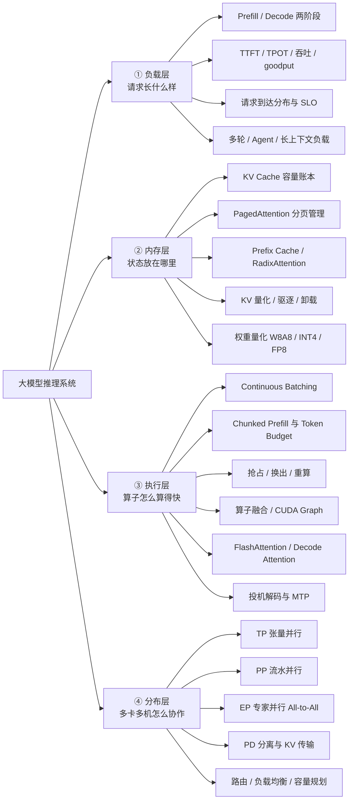
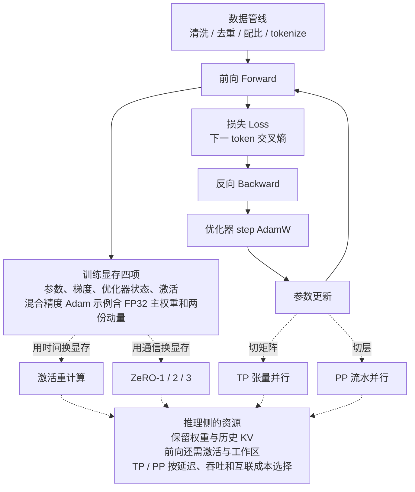

# AI Infra 学习手册与路线图

> **面向对象**：已掌握 Python / PyTorch，每周可稳定投入 40 小时，期望 3 个月内从系统入门走到进阶的工程师。
>
> **时间预算**：12 周 × 40 小时 = 480 小时，其中模块学习与实验 440 小时、缓冲 40 小时。模块工时分为推理 332 小时、训练与硬件 80 小时、公共基础 28 小时。
>
> **资料基础**：5 份在线资料 + 2 本本地 PDF，共 7 份。所有目录均经**侧边栏 / `llms.txt` / PDF 书签树**全量核实，正文为抽样精读。核实方式与缺口见 [附录 A](#附录-a资料目录盘点与核验记录)。
>
> **编制日期**：2026-11-15

---

## 如何使用这份手册

先在一张 GPU 上建立可复现的推理服务，再用自己写的迷你引擎解释显存和调度行为。第 12 周交付一份可复跑的性能报告，并用一次陌生负载完成诊断。

1. **先看本阶段的验收要求。** 第 2 周通过基础验收后，先用 M3.1 的 6 小时跑第一次服务压测。后续模块尽量复用同一模型、两组请求和同一套计时口径。
2. **为每个必修模块留下证据。** 例如，先用模型配置算出每个 token 的 KV 字节数，再用引擎实际分给 KV 的空间推算块数，记录两份数字及差异来源。
3. **区分可计算的答案与待检验的假设。** 参数量、块表边界、指标单位可以核对。吞吐变化、尾延迟和量化质量要保留原始数据，重复测量并解释差异，也可以得出“在本次测量范围内无显著变化”。

### 全文记号约定

| 记号 | 含义 | 使用方式 |
|---|---|---|
| `[主读]` | 本模块的主要资料 | 优先读与练习相关的小节 |
| `[补充]` | 源码、图解或延伸材料 | 遇到具体问题时查 |
| `L0` | CPU / Apple Silicon | 可做账本、单测、调度仿真 |
| `L1` | 一张可运行所选模型及工具的 GPU | 本手册的单卡实测按 NVIDIA / CUDA 环境编排。W2 先用放得下的小模型，显存须容纳权重、KV 与运行时工作区 |
| `L2` | 多卡拓展 | 两卡可做分片或 1P1D；TP=4 需要四卡。W3 可采训练数据，W9 集中采推理数据 |
| `P0 / P1 / P2` | 主线 / 选修 / 加分 | 以各阶段的必修验收为准。选修预算可用于返工和复测 |

**硬件选择**　单卡路线用本机服务实测完成全部必修验收。分布式部分交逐卡账本、仿真或带出处的公开 trace，并标明证据来源。有多卡窗口时，再添加同模型、同负载的实测对照。

### 术语与引用格式

- 网页资料引用格式：`资料名 › 模块/篇 › 章 › 小节（URL slug）`
- PDF 引用格式：`章节号 + 小节 + (p页码)`
- ⚠️ 两本 PDF 的**书签页码是 PDF 物理页序，不等于印刷页码**（存在偏移）。翻页时以 `Ctrl/Cmd+F` 搜小节标题为准。

---

# Part 1：资料定位速览表

## 1.1 七份资料总览

| # | 资料 | 形态与已核实规模 | 侧重点 | 难度 | 本计划角色 | 主要出场 | 已知缺口 |
|---|---|---|---|---|---|---|---|
| 1 | **图解大模型**（PDF）<br>Jay Alammar & Maarten | 409 页，3 部分 12 章 + 附录 A（图解 DeepSeek-R1）+ 面试题 200 问，245 条书签 | 用图讲"为什么这样设计"。KV Cache、Transformer 块、微调三步走讲得最不费脑 | ★★☆☆☆ | **入门打底 / 直觉供给** | Phase 1 全部、Phase 2-M2.5、Phase 5-M5.5 | 系统层内容基本没有，不能当 Infra 教材 |
| 2 | **大模型原理与架构**（站）<br>yeasy | 14 章 + 附录 A.1–A.8，四部分（基础/训练/推理与部署/模型与前沿） | 每个设计决策的**动因与数学**：为什么除 √d、为什么 Pre-Norm、为什么 RoPE 能外推 | ★★★☆☆ | **原理主线 / 查漏补缺** | Phase 1-M1.1/M1.3、Phase 3-M3.2/M3.5、Phase 5-M5.5 | 偏原理，工程量化不如资料 3，代码不如资料 5 |
| 3 | **AI-Infra-Book**（PDF）<br>《深入理解 AI Infra：量化分析与系统设计》 | 536 页，12 章，121 条书签 | **量化账本**：每章都有实测算例、"谬误与陷阱"、"本章数字速查"、"练习与复现" | ★★★★★ | **量化主教材（核心）** | Phase 1-M1.2、Phase 2-M2.1/M2.2/M2.4、Phase 3-M3.1/M3.2/M3.3、Phase 4-M4.3/M4.5/M4.6 | 需要较强数学/系统功底；不含逐行代码 |
| 4 | **ai infra handbook**（站） | **17 篇 / 133 讲**，从"01 向量"到"133 怎么读大型引擎的源码" | **最小依赖顺序的工程全景**：每讲只讲一个点，读到任何一讲时前置概念都已讲过 | ★★★☆☆ | **工程全景主线** | Phase 3-M3.6（v0–v3 必修，v3+/v4/v5 为拓展）、Phase 5-M5.3（nano-vllm / 引擎源码） | 深度偏入门，单讲篇幅短；正文未逐讲精读 |
| 5 | **ai infra guide**（站）<br>caomaolufei | 4+1 模块。模块四推理优化 **40 篇 / 9 章**（逐篇标题已核实） | **检验标准 + 源码解读**：每一层都给可量化的过关线；nano-vllm 逐模块拆解 6 篇 | ★★★★☆ | **实战与源码主线** | Phase 3-M3.2/M3.3/M3.5、Phase 4-M4.1/M4.2、Phase 5-M5.3 | 模块二/三只到章级；模块四第 7、8 章无小节标题 |
| 6 | **llm-algo-leetcode**（站）<br>Datawhale | Part 00（5组20节）/ 01（6组34节）/ 02（10组，编号 00–89）/ 03 Triton（5组15节）/ 04 CUDA（4组16节）/ 05 项目 + 14 专题 | **Notebook-first 手撕题库**：题目区、答案区、基础验证、真实 backend 对照 | ★★★★☆ | **实战题库（手撕）** | Phase 1-M1.2/M1.4、Phase 3-M3.2/M3.3/M3.7、Phase 4-M4.1/M4.2/M4.5、Phase 5-M5.4 | **Part 04 / Part 05 建设中**；多个专题亦是建设中 |
| 7 | **AI Systems Performance Engineering**（站）<br>Chris Fregly 中译 | 20 章 + 附录。ch6–12 CUDA/Kernel，ch13 PyTorch 剖析，ch15–20 推理/PD/KV 调优 | **底层拔高的工程细节**：占用率、warp 效率、访存模式、Nsight、PD 扩展、KV 调优 | ★★★★★ | **底层进阶** | Phase 4-M4.1/M4.2/M4.4、Phase 4-M4.6、Phase 5-M5.2 | 机器翻译初稿，译者自述"格式错乱、翻译不准确"。**关键数字必须回 NVIDIA 官方文档核验** |

## 1.2 四种角色，各归其位

| 角色 | 承担资料 | 为什么不换 |
|---|---|---|
| **主线教材（量化）** | 资料 3 `AI-Infra-Book` | 全计划唯一"每个结论都带实测数字 + 每章点破常见谬误"的书。它建立的不是知识而是**判断力**：看到一个优化方案，先算上限再判断值不值 |
| **主线教材（全景）** | 资料 4 `ai infra handbook` | 133 讲按依赖排序，是全计划唯一能"从 0 顺着走一遍不掉队"的路线。适合当骨架 |
| **实战与源码** | 资料 5 `ai infra guide` + 资料 6 `llm-algo-leetcode` | 资料 5 提供**过关线**与 nano-vllm 源码解剖；资料 6 提供**可运行题目**。两者互补：一个告诉你"到什么程度算会"，一个给你"练到那个程度"的题 |
| **底层进阶** | 资料 7 `AI Systems Performance Engineering` | 只有它把 CUDA 占空比、warp 效率、Nsight SOL 面板讲到能上手调优的程度 |
| **原理查漏** | 资料 2 `大模型原理与架构` | 当你在别处看到"就这样做"却不知为何时，回这里找动因 |
| **入门打底** | 资料 1 `图解大模型` | 第一周用它看懂 Transformer 与 KV Cache，再用 M1.1–M1.3 的账本检验理解 |

## 1.3 ⚠️ 资料边界与缺失说明（重要，请先读）

你的要求是"严禁凭借记忆编造资料中不存在的章节名"。以下是本次核验的**真实边界**，手册会严格遵守：

**已完整核实（可放心引用到小节级）**
- ✅ `ai infra handbook`：首页即完整侧边栏，**17 篇 / 133 讲逐讲标题全部取得**。
- ✅ `AI-Infra-Book`：PyMuPDF 提取 **121 条书签**，章→节→页码完整。
- ✅ `图解大模型`：PyMuPDF 提取 **245 条书签**，含四级标题与页码。
- ✅ `大模型原理与架构`：官方 `llms.txt` 提供**全部 14 章 + A.1–A.8 逐节标题与 slug**。
- ✅ `ai infra guide` 模块四：`/inference/` 模块索引页列出 **9 章 40 篇**，逐篇标题已取得。

**只到章级（不会编造小节号）**
- ⚠️ `ai infra guide` **模块四第 7 章「Prefill/Decode 解耦架构」与第 8 章「生产部署与运维」**：站点未列出小节标题，因此手册**只引用到章级**。
- ⚠️ `ai infra guide` 模块一 / 二 / 三：手册只引用已确认的章与篇（如"模块二 第1章 CUDA 编程入门""模块三 21 集合通信原语详解"），不臆造更细层级。
- ⚠️ `AI Systems Performance Engineering`：仅核实**20 章章级标题**，未逐章取小节。

**明确标注"建设中"（不要依赖其完整性）**
- ⚠️ `llm-algo-leetcode`：**Part 04（CUDA C++ 与系统优化，4 组 16 节）与 Part 05（综合项目）状态为"建设中"**。大模型架构演进、后训练优化、性能优化、算子优化四条主路线，以及数据工程、部署与异构、Agent、多模态四个专题也标注建设中。
  → **对策**：手册把 CUDA 手撕主线押在资料 5 模块二 + 资料 7，把项目收口押在 Part 02 的编号项目（66/67/68/69/70/81/83，状态为已完成/持续优化），不押 Part 04/05。

**其他诚实声明**
- 本次 7 份资料入口**全部 HTTP 200**，未遇权限墙或付费墙。缺失的是"正文逐页精读"，不是"目录不可得"。
- 手册中对资料 4、5、7 及两本 PDF 的定位，依据是**目录标题语义 + 抽样正文**。凡引用未读正文者，措辞为"该章标题指向……"，不做内容断言。
- `AI Systems Performance Engineering` 为中英对照机翻稿，**所有性能数字（TFLOPS、带宽、延迟）以 NVIDIA 官方文档或原书为准**，手册中引用时会标注 `[需回原文核验]`。

---

# Part 2：全局技术知识图谱

## 2.1 图 A：推理生命周期主链（瓶颈随阶段迁移）



**这张图要背下来的三件事**

1. **先看请求长度和批量。** 长 prompt 的 prefill 可以把许多输入 token 合成大矩阵乘。单请求 decode 每步生成 1 个 token，稠密层读取一份 BF16 权重约做一次乘加。批量增大时权重可以复用，长上下文还会增加 KV 读取量。
2. **用同一硬件上的计算量和读写量估计瓶颈。** 教材 p31 的 Qwen3-8B 算例固定 BF16、batch=1、上下文 2048。
   - prefill 矩阵运算约 **29.69 TFLOPs**。完整权重占用 **16.38 GB**；计算实际算术强度还要计入执行中的激活、读写和复用。
   - 一步 decode 约 **16.34 GFLOPs**，主要权重读取 **15.14 GB**，旧 KV 读取 **0.302 GB**。按这两项估算约为 **1.06 FLOP/byte**。
   - 教材所用 RTX PRO 6000 的机器平衡点约为 **281 FLOP/byte**（503.8 TFLOP/s ÷ 1.792 TB/s）。在这个单请求算例里，先检查 decode 的带宽利用率和两次 kernel 之间的空隙。

3. **吞吐与延迟是两个目标函数。** 批内复用提高的是**吞吐**（每 token 分摊的权重读取变少），但对**单请求延迟**改善有限——每个请求仍要排队并等整批执行。

## 2.2 图 A′：推理知识地图（四层瓶颈与对策）



## 2.3 图 B：训练框架树（与推理的衔接点）



**训练 → 推理的三条衔接关系**

| 衔接点 | 训练侧 | 推理侧 | 你能解释什么 |
|---|---|---|---|
| **显存构成** | 参数 + 梯度 + 优化器状态 + 激活（本计划的混合精度 Adam 假设下，前三项合计 **16 bytes/参数**，激活另算） | 参数 + KV Cache + 激活/工作区（无梯度、无优化器状态） | 为什么"训练放不下 7B 的卡，推理能放下"；为什么推理的瓶颈从显存**容量**转到显存**带宽** |
| **并行策略** | TP 通信密集，优先映射到高速互联域、PP 有气泡、ZeRO 用通信换显存 | TP 降低单请求延迟但增加通信、PP 改请求级流水、EP 面对 All-to-All | 为什么"训练能用的切法"在推理里代价不同；为什么 MoE 推理瓶颈常在网络 |
| **状态管理** | 检查点、故障恢复、激活重计算 | KV Cache 分配/复用/释放、抢占与重算、KV 迁移 | 为什么 `AI-Infra-Book` 把 KV 分页管理类比操作系统的分页（p30 提示这一类比） |

## 2.4 表 C：推理 vs 训练 12 项对比

| 维度 | 训练（预训练 / 微调） | 推理（在线服务） |
|---|---|---|
| **主瓶颈** | 算力（大矩阵乘）+ 显存容量（优化器状态） | **显存带宽**（decode 读权重）+ 显存容量（KV Cache） |
| **显存构成** | 参数 2B + 梯度 2B + 优化器 12B + 激活（可变） | 参数 2B（或量化后 1B/0.5B）+ KV（随并发线性涨）+ 工作区 |
| **并行首选** | ZeRO/FSDP（切状态）→ TP（切矩阵，机内）→ PP（切层，跨机） | TP（机内，降延迟）→ DP（副本，提吞吐）→ EP（MoE）→ PD 分离 |
| **Batch 语义** | 固定 global batch，梯度累积补足 | 动态连续批处理，请求随到随走、随完随退 |
| **精度诉求** | 按精度配置混合精度策略；FP16 常用 loss scaling，BF16 通常可直接训练 | W8A8/AWQ/FP8/KV 量化，需精度退化可接受 |
| **计算形态** | 一次前向 + 一次反向，形状固定 | 一次大 prefill + N 次小 decode，形状随请求变 |
| **故障影响** | 一次故障损失数小时算力，需断点续训 | 一次故障影响在途请求，需优雅降级与重路由 |
| **核心 KPI** | tokens/s/GPU、MFU、收敛步数、loss 曲线 | TTFT、TPOT、吞吐（tok/s）、**goodput**（满足 SLO 的有效吞吐）、P95/P99 |
| **优化杠杆** | 重计算、卸载、通信重叠、并行切分 | 分页、批处理、前缀复用、量化、投机解码、PD 分离 |
| **典型工具** | Megatron-LM、DeepSpeed、FSDP、Nsight | vLLM、SGLang、TensorRT-LLM、`vllm bench serve`、AIPerf |
| **成本单位** | 元/（GPU·小时）→ 折算到每次训练 | **元/百万输出 token**（单卡时价 × 卡数 × 10⁶ ÷ 每小时输出 token 数） |
| **面试高频** | ZeRO 三阶段差异、PP 气泡、BF16 vs FP16 | KV 显存公式、PagedAttention 为什么省、CB 与静态批的差别、PD 为什么要拆 |

---
# Part 3：分阶段体系化学习路线

## 3.0 总览与工时总账

| Phase | 主题 | 工时 | 周次 | 推理/训练归属 | Gate 一句话 |
|---|---|---|---|---|---|
| **P1** | 筑基：模型架构、计算与显存 | 56h | W1–W2 | 公共 28 / 推理 28 | 核对三本账，并验证迷你 GPT 的缓存实现 |
| **P2** | GPU、通信与训练框架 | 80h | W2–W4 | 训练与硬件 80 | 判断训练配置在给定卡数和显存下是否可行 |
| **P3** | **推理全流程与引擎核心** | **140h** | W2 提前建基线，W4–W8 深入 | 推理 140 | 交付 v0–v3、单测和同负载的实测表 |
| **P4** | 性能归因、算子与分布式推理 | 104h | W8–W11 | 推理 104 | 用本机 trace 检验瓶颈假设；多卡按窗口拓展 |
| **P5** | 服务压测、终局项目与诊断 | 60h | W11–W12 | 推理 60 | 单卡可复现报告及 30 分钟陌生场景诊断 |
| — | 实验返工、补测与排期缓冲 | 40h | W2–W12 | 公共 40 | 当周可用 |
| | **合计** | **480h** | **12 周** | **推理 332 / 训练与硬件 80 / 公共 68** | |

> Phase 2 的硬件与通信基础也用于推理，按模块预算只计一次。Phase 3 的 140h 含第 2 周建服务的 6h。先写准 KV 账本，再把分页与调度接到同一个引擎里，最后用早期服务的基线做对照。

---

## Phase 1：筑基 —— 大模型架构与计算/显存直觉

> **56h ｜ W1–W2 ｜ 公共地基 28h + 推理前置 28h**
>
> **本阶段唯一目标**：把"模型是什么"从"PyTorch 里能跑"升级为"我能用公式描述它的计算量与显存"。这是后面所有 Infra 讨论的语言基础——听不懂 Roofline 是因为算不出 FLOPs，看不懂 PagedAttention 是因为算不出 KV 大小。
>
> **W2 衔接**：先完成本阶段的白板、账本和迷你 GPT。通过 Gate 后，用 M3.1 的前 6h 在单卡启动一个显存放得下的小模型，保存请求、环境和第一份延迟/吞吐记录。这 6h 计入 M3.1，后续都沿用该基线。

### M1.1 Transformer 数据流与维度推导　`14h`　`P0`　`L0`

**学习目标**
- 能不看资料，在白板上画出 **Pre-Norm Decoder Block** 的完整结构，并标注每一步的张量形状。
- 能解释 8 个"为什么"：为什么除 √d_k、为什么多头、为什么残差、为什么 Pre-Norm、为什么换 RMSNorm、为什么 RoPE 能表达相对位置、为什么 SwiGLU 有三个矩阵、为什么 MQA/GQA 能省 KV。
- 能用 KV 头数推算 MHA、MQA、GQA 的缓存容量，并指出 MLA 还需要哪些配置才能估算。

**核心知识点清单**
1. **前向数据流**：token id → embedding `(B,S,d)` → N × Block → final norm → lm_head `(B,S,V)` → logits
2. **注意力投影与计算**：由输入分别计算 Q、K、V，求 `QKᵀ/√d_k`，加因果 mask、做 softmax，再乘 V。把各头的结果拼接后乘输出投影 `W_o`。每一步的 shape 都要能口述。
3. **缩放因子**：为什么是 `√d_k` —— QK 点积方差随 d_k 线性增长，不缩放会让 softmax 进入饱和区、梯度消失
4. **多头**：为什么切头比整体算更好 —— 多个子空间独立投影，等价于在不同表示子空间做检索；总计算量与单头 `d` 相同
5. **注意力变体与 KV 头数**：MHA（`n_kv = n_head`）→ MQA（`n_kv = 1`）→ GQA（`n_kv = n_group`）→ MLA（低秩压缩 + 重建）。**这是后面省 KV 显存的第一根杠杆**
6. **位置编码**：正弦编码 → 可学习 → RoPE（复数旋转 / 二维旋转矩阵）。RoPE 的"相对性"来自 `⟨R_m q, R_n k⟩ = f(m−n)` 这一性质
7. **归一化**：LayerNorm vs RMSNorm；Post-Norm vs Pre-Norm（Pre-Norm 让残差主干保持恒等通路，深模型更稳）
8. **FFN / SwiGLU**：`d → d_ff → d` 三矩阵版本 `(W_gate, W_up, W_down)`，参数量约 `3·d·d_ff`
9. **参数量拆解**：一层 GQA 的 Q、K、V、O 四个投影共 `2·d·(n_head+n_kv)·d_head`，再加 SwiGLU 的 `3·d·d_ff`。输入 embedding 占 `V·d`，输出头绑权时共用这份参数，未绑权时另计一份。精确计数还要加各项 norm 与实际启用的 bias。[Qwen3-8B 官方配置](https://huggingface.co/Qwen/Qwen3-8B/blob/main/config.json)

**精准资料映射**
- `[主读]` 图解大模型 › 第3章 LLM的内部机制 › 3.1.1 已训练Transformer LLM的输入和输出（p94）／3.1.2 前向传播的组成（p96）／3.1.6 Transformer块的内部结构（p103）／3.2.1 更高效的注意力机制（p111）／3.2.3 位置嵌入（p117）
- `[主读]` 大模型原理与架构 › 第一部分 基础篇 › 第2章 注意力机制 › 2.2 缩放点积注意力／2.3 多头注意力／2.4 自注意力、交叉注意力与因果掩码；第3章 3.4 前馈网络／3.5 残差连接／3.6 层归一化；第4章 4.3 旋转位置编码
- `[补充]` ai infra handbook › 第4篇 Transformer 核心（25–35 讲）／第5篇 现代 LLM 架构（36–44 讲）
- `[补充]` AI-Infra-Book › 第2章 2.1 计算图与前向执行（p33）／2.5 网络形状与计算组织（p59）

**动手练习与验收标准**
1. **白板默写（P0）**：A4 纸上手绘 Pre-Norm Block，标注 `(B,S,d) → (B,n_h,S,d_h) → …` 全链路，限时 10 分钟。验收：8 个子模块一个不漏，shape 全部正确。
2. **代码对照（P0）**：自己实现 `MultiHeadAttention`（含 GQA 参数 `n_kv`），与 `torch.nn.functional.scaled_dot_product_attention` 对齐。验收：随机输入下 `max|Δ| < 1e-5`。
3. **公式卡片（P0）**：产出 `w01_arch_formulas.md`，写出参数量、KV 显存、prefill FLOPs、decode FLOPs 四个公式。用 Qwen3-8B 校验整张表，写明头数、精度、上下文与是否绑权。7B/70B 和 MoE 模型可选做，MoE 另分总参数与激活参数。
4. **KV 头数实验（L0）**：给定 `L=32, d=4096, n_head=32, d_head=128`，分别算 MHA / GQA(n_kv=8) / MQA 在 `S=4096, B=16, FP16` 下的 KV 总量。验收：GQA 本例为 MHA 的 1/4。MLA 另需缓存的潜变量维度、位置分量维度、实际存储布局与精度。

---

### M1.2 参数、FLOPs、显存：三本账　`14h`　`P0`　`L0`

**学习目标**
- 拿到任意一个模型配置，能在 3 分钟内**手算**出：总参数量、权重显存、单次 prefill FLOPs、一步 decode FLOPs、单 token KV 字节数。
- 理解"数量级估算"为什么是 AI Infra 的核心技能：所有架构决策都是**比例**决定的，比例变了，原来不划算的方案就变划算。
- 能识破 5 个常见谬误（见下）。

**核心知识点清单**
1. **FLOPs ≠ FLOPS**：前者是运算总量（次），后者是算力（次/秒）。`时间下界 = 计算量 / 峰值算力`
2. **参数量估算**：标准 Transformer 常近似为 `12·L·d²`。对无偏置的稠密 GQA + SwiGLU，令 `A = 2·d·(n_h+n_kv)·d_h`（Q、K、V、O 四个投影），`F = 3·d·d_ff`，`E = V·d`。总参数为 `L·(A+F) + E + 未绑权时的 E + 各 norm 参数`。Qwen3-8B 的输入输出未绑权，加上每层输入/FFN 两个 RMSNorm、Q/K 两个 head norm 及 final norm，共 8,190,735,360 个参数，BF16 权重约 16.38 GB。[Qwen3-8B 模型配置](https://huggingface.co/Qwen/Qwen3-8B/blob/main/config.json) · [Qwen3 模型实现](https://github.com/huggingface/transformers/blob/main/src/transformers/models/qwen3/modeling_qwen3.py)
3. **权重显存** = `参数量 × 每参数字节数`（BF16 = 2B、FP8 = 1B、INT4 ≈ 0.5B + scale 开销）
4. **prefill 计算量**：稠密模型、单请求、因果 attention 仅计有效三角区域、只投影最后一个位置的 logits 时，主要矩阵运算约为 `2·L·(A+F)·S + 2·L·n_h·d_h·S·(S+1) + 2·E`。若对每个位置都求 logits，末项改为 `2·E·S`。embedding 查表不按全矩阵乘法计。
5. **decode 计算量**：缓存已覆盖约 S 个位置时，一步的主要矩阵运算约为 `2·[L·(A+F)+E] + 4·L·n_h·d_h·S`。batch=1 时主要读取这些线性层的权重以及历史 KV。prefill/decode 两式均以一次乘加为 2 FLOPs，省略 norm、softmax 等逐元素运算。
6. **算术强度** = `FLOPs / Bytes`，与机器平衡点（`峰值算力 / 峰值带宽`）对比即知受限于谁
7. **五个常见误区**：①峰值算力翻倍 ≠ 速度翻倍；②显存装得下权重 ≠ 支持目标并发；③比旧实现快 30% ≠ 优化成功（要先算上限）；④吞吐提高 ≠ 用户等待变短；⑤上一代负载成熟的设计 ≠ 可直接套用新负载
   > 这五条来自 `AI-Infra-Book` 第1章"谬误与陷阱"（p30–31），后续每章都有同栏目。**建议把这五条抄在笔记本第一页**

**精准资料映射**
- `[主读]` AI-Infra-Book › 第1章 初识 AI Infra › 1.2 系统设计的关键数字（p17）／1.3 用几个数字估算一次模型执行（p21）／1.4 需求如何推动架构设计（p27）／**谬误与陷阱 + 本章数字速查（p30–31）**
- `[主读]` AI-Infra-Book › 第2章 模型架构 › 2.2 自回归生成的资源消耗计算（p41）／2.6 整个模型的资源需求与比较（p62）／**模型矩阵查阅表（p74）**
- `[补充]` ai infra handbook › 11 计算量与 FLOPs／35 参数量与计算量／67 理论 vs 实测／71 显存账本／72 推理成本模型
- `[补充]` llm-algo-leetcode › Part 01 › 1A 数值与规模 › 01 数据类型与精度／02 参数量与 FLOPs
- `[补充]` 大模型原理与架构 › 附录 A.1 数学基础速查／A.3 主流模型参数速查表

**动手练习与验收标准**
1. **三本账脚本（P0，L0）**：写 `w01_ledger.py`，输入模型配置（含 `head_dim`、`tie_word_embeddings`）、上下文、并发和 dtype，输出总参数、权重显存、prefill/decode FLOPs、单 token 与单请求 KV、可容纳并发估算。验收：Qwen3-8B 的 BF16 单 token KV 为 **144 KiB**（36 层 × 8 个 KV 头 × 128 维 × 2（K 和 V）× 2 字节 = 147,456 B）。
2. **复算书上的例子（P0，L0）**：不看答案，独立复算 p31 "本章数字速查"表里 7 个数字（16.38 GB / 144 KiB / 288 MiB / 29.69 TFLOPs / 16.34 GFLOPs / 15.14 GB / 0.302 GB），每个误差 < 5%。**这是本模块的硬验收线。**
3. **算力/带宽对照（P0，L0）**：对 H100 SXM 与 RTX 4090，用硬件速查卡上的 BF16 稠密算力和显存带宽计算机器平衡点。在 batch=1、2K 上下文下估算这一步 decode 的算术强度，并解释提高峰值算力是否会改变 Roofline 的限制项。
4. **谬误清单（P0，L0）**：产出 `w01_fallacies.md`，把五条谬误各配一个自己的例子（可以是工作里见过的、或网上看到的错误说法）。验收：每条能说出"它错在哪一步计算"。

---

### M1.3 自回归生成与 KV Cache 的第一性原理　`14h`　`P0`　`L0`

**学习目标**
- 能分别解释 KV Cache 省下的历史投影/前向重算与仍需执行的注意力。使用全注意力时，新 query 仍要访问历史 KV，单步随上下文增长。
- 能算出 KV Cache 的完整容量账本，并判断"这台机器的显存到底能给多少并发"。
- 能说清 KV Cache 带来的三个新问题：**容量随上下文线性增长、碎片化、独立分配导致相同前缀重复存储**——这三个问题正是 PagedAttention / Prefix Cache 的动机。

**核心知识点清单**
1. **自回归的重复计算**：生成第 N 个 token 时，前面 N−1 个 token 的 K、V 已经算过且**永远不变**（因果 mask 保证）。重复算 = 浪费
2. **KV Cache 的本质**：用显存换计算。**存的不是"结果"，是每一层的 K 和 V 张量**
3. **容量公式**（必须背）：`KV = 2 × L × n_kv × d_head × S × B × bytes_per_elem`
   - `2` 是 K 和 V 各一份；`S` 是序列长度；`B` 是并发数
4. **KV 与权重谁大**：长上下文时 KV 会**超过**权重。Qwen3-8B 权重 15.3 GiB，而 8192 token 上下文 = 1152 MiB KV，**16 条这样的请求就需要 18 GiB > 权重**
5. **两阶段的显存需求差异**：prefill 同时处理多个 token，中间张量和工作区可较大。推理无需为反向保留各层激活。decode 的当前 token 激活较小，访问的历史 KV 随上下文增长。
6. **KV Cache 的三个衍生问题**：①按 `max_len` 预分配 → 显存浪费（内部碎片）；②变长请求 → 外部碎片；③相同前缀重复存 → 冗余
7. **缓存表示**：MQA/GQA 减少存储的 KV 头数；MLA 缓存压缩表示等分量，应按模型配置和后端实际存储的维度计算。

**精准资料映射**
- `[主读]` 大模型原理与架构 › 第三部分 推理与部署篇 › 第10章 推理优化：第一性原理的分析 › 10.1 推理瓶颈分析：计算密集还是访存密集／10.2 KV 缓存：为什么能避免重复计算
- `[主读]` 图解大模型 › 第3章 › 3.1.4 并行词元处理和上下文长度（p100）／**3.1.5 通过缓存键−值加速生成过程（p102）**  ← 建立直觉的最佳入口，含 `use_cache=True/False` 的计时对比
- `[主读]` AI-Infra-Book › 第2章 › 2.3 上下文状态表示与访问机制（p44）；第8章 › 8.1 推理请求的执行过程与资源需求（p327）
- `[补充]` ai infra handbook › 68 Prefill 与 Decode／69 KV Cache／71 显存账本
- `[补充]` llm-algo-leetcode › Part 02 › 2.6 推理执行与生成加速（组页）；INF-REQUEST-LIFECYCLE 请求生命周期

**动手练习与验收标准**
1. **复现书上的时间线（P0，L0）**：手算 `AI-Infra-Book` p328 的例子：排队 0.1s + prefill 0.096s + 255 × 0.0265s = **6.95 s**。然后算：若中途插入另一条短请求的 prefill（+0.096s），总时长变成多少？验收：得到约 **7.05 s**（原文结论），并能解释"计算内容一点没变，只是执行顺序变了就超时"——这是后面所有调度技术的动机。
2. **KV 账本脚本（P0，L0）**：扩展 `w01_ledger.py`，输入显卡容量与 `max_model_len`，分别列出权重、工作区及运行时预留，在剩余 KV 预算内估算 token 槽与等效并发。验收：对 80GB 卡 + Qwen3-8B(BF16) + 32K 上下文，给出并发数并与直觉核对（是否远低于你的预期？为什么）。
3. **缓存开关实测（P1，L0/L1）**：有余时用小模型同一 prompt 做贪心生成，固定生成长度，比对 `use_cache=True/False` 耗时。记录硬件、batch 和长度，说明哪部分计算发生了变化。
4. **写一段 300 字解释（P0，L0）**：向"不懂 AI 的同事"解释 KV Cache。验收：不含公式，但把"为什么能省""省的是什么""代价是什么"三点说清。

---

### M1.4 手写迷你 GPT（含 KV Cache 版）　`14h`　`P0`　`L0`

**学习目标**
- 把前三个模块的知识**落成可运行代码**：一个参数量 ~10M 的 GPT，先做训练（几步即可），再做两种生成——朴素重算版 vs KV Cache 版。
- 亲手测出 KV Cache 的加速比，并与理论值对比。
- 为 Phase 3 的 M3.6（手写迷你推理引擎）打好代码底座：那时只需在同一个模型上加调度与分页。

**核心知识点清单**
1. **最小 GPT 组成**：`Embedding → [LN → MHA → 残差 → LN → FFN → 残差] × N → LN → lm_head`
2. **因果 mask 的构造**：上三角 `-inf`，`softmax` 后变 0 权重；训练时一次算全序列，推理时只需算最后一个
3. **训练 vs 推理的 forward 差异**：训练输入 `(B,S)` 全序列；推理 prefill 输入 `(B,S)`，decode 输入 `(B,1)` 但需拼接历史 KV
4. **KV Cache 的数据结构**：每层存两个 `(B, n_kv, S_max, d_head)` 张量 + 一个 `cur_len` 指针
5. **采样**：temperature / top-k / top-p 的实现与它们对分布的影响
6. **权重加载**：把 GPT-2 或 Qwen 的小模型权重塞进自己的实现，验证结构正确（这是检验 Transformer 理解最狠的方式）

**精准资料映射**
- `[主读]` ai infra handbook › 第7篇 从零实现一个 GPT 模型（52 语料与分词器／53 数据加载器与嵌入／54 因果多头注意力／55 组装 GPT／56 预训练／57 解码与存档／58 装进 GPT-2 的权重／59 指令微调）　← **这是全站最适合本模块的一篇，按顺序做**
- `[主读]` 大模型原理与架构 › 附录 A.2 PyTorch 实现示例（含 attention / RoPE / RMSNorm 的参考实现）
- `[补充]` 图解大模型 › 第3章 3.1.3 从概率分布中选择单个词元（p98）／3.1.4 并行词元处理和上下文长度（p100）
- `[补充]` llm-algo-leetcode › Part 00 › 0D Transformer Block 与模型组件；Part 02 › 2.1 基础算子与 Attention（00–04）
- `[补充]` 大模型原理与架构 › 第3章 3.8 GPT 式仅解码器：一次回答如何生成

**动手练习与验收标准**
1. **朴素生成器（P0，L0）**：实现 `generate_naive()`：每步把整个前缀重新前向。验收：固定小模型权重和 prompt 后，保存参考实现的下一 token logits，逐步验证前向与贪心输出。预训练权重对拷留给第 4 项。
2. **KV Cache 生成器（P0，L0）**：实现 `generate_kv()`，每步只前向 1 个 token。验收：用固定权重、固定 prompt、eval 模式和 FP32 对照逐步 logits（注明容差），并检查贪心 token。若 token 不同，检查差异是否由并列或接近并列的 logits 引起，再定位 mask、位置与 cache 索引。
3. **加速比实测（P0，L0）**：L0（CPU）上比较两个版本生成 200 token 的耗时；若有 L1 环境再测一次 GPU。验收：记录 batch、输入/输出长度和计时方法，解释观察到的加速比。
4. **权重对拷（P1，L0）**：加载 `gpt2` 权重到自己实现，对比同一 prompt 下 logits。验收：`max|Δ| < 1e-3`；若失败，必须能定位是 `c_attn` 的 QKV 拼接顺序、还是 `c_proj` 的转置问题。
5. **P2 精修**：在已交付的 `w02_minigpt.py` 上加 top-p 采样与重复惩罚。Phase 3-M3.6 沿用通过对照测试的贪心版本。

---

### ✅ Phase 1 阶段 Gate

通过以下项目后，在 W2 开始 M3.1 的 6h 基线并衔接 Phase 2：

- [ ] 白板 10 分钟默写 Pre-Norm Block + 全链路 shape，零错误
- [ ] `w01_ledger.py` 复算 `AI-Infra-Book` p31 七个数字，每个误差 < 5%
- [ ] 手算 Qwen3-8B 单 token KV = **144 KiB**，并说清每一步乘法代表什么
- [ ] `w02_minigpt.py` 的 KV Cache 与朴素生成通过 M1.4 的逐步 logits、贪心 token 对照，保存测试输入与误差
- [ ] 能向非技术同事解释 KV Cache，且说清"代价是什么"
- [ ] 五条谬误能各举一例

---

## Phase 2：GPU 硬件基础与训练框架全景

> **80h ｜ W2–W4 ｜ 全部计入训练侧**
>
> **本阶段定位**：这是**唯一**大块讲训练的窗口。目标不是"会训模型"，而是：
> ①拿到 GPU 能说清它的能力边界（算力/带宽/互联）；②能算清训练显存，从而理解为什么推理的显存结构和它完全不同；③能设计多卡并行方案并说清通信代价；④补上后训练链路（SFT/LoRA/DPO）的全景，避免面试被问"你们怎么微调的"时卡住。
>
> **与推理的衔接**：M2.1 的 Roofline 与 M2.2 的通信模型，会在 Phase 4 直接复用；M2.3 的显存账本与 M2.4 的并行策略，会在 M3.x / M4.5 以推理场景重现。W3 有两卡可连做通信和 DDP/FSDP。只拿到单卡时，保留基准、显存账本与拓扑推算，有余量可在 W9 补实测。两条路径均可过本阶段 Gate。

### M2.1 GPU 架构、存储层次与 Roofline　`20h`　`P0`　`L1`

**学习目标**
- 能画出 GPU 存储层次（寄存器 → 共享内存/L1 → L2 → HBM → 主机内存），说出各层的量级（容量、延迟、带宽）。
- 能用 Roofline 判断一个算子（GEMM / softmax / attention / decode FC）**卡在算力还是带宽**，并给出可达性能上界。
- 能解释"为什么 decode 阶段把 batch 调大能提吞吐"——同一个 Roofline 图上的工作点移动。

**核心知识点清单**
1. **SM 与执行单元**：SM 数量、CUDA Core、Tensor Core、Warp（32 线程）、占用率（Occupancy）
2. **存储层次量级**（以 H100 为锚）：寄存器 256KB/SM、共享内存 228KB/SM、L2 约 50MB、HBM3 80GB / 约 3.35 TB/s
3. **Roofline 模型**：`可达算力 = min(峰值算力, 带宽 × 算术强度)`；在 log-log 图上是一条"斜线 + 水平线"
4. **算术强度**：见 M1.2 第 6 点。以小 batch、稠密模型的教材算例为起点，分别标出 prefill 与 decode。改变序列长度、batch 或算子后，重新判断工作点。
5. **Memory Wall**：为什么显存带宽往往比算力先成为瓶颈
6. **低精度计算**：FP16/BF16/FP8/FP4 的格式差异（指数位/尾数位）、Tensor Core 的加速比、精度损失的来源
7. **数据搬移**：片上（共享内存）→ 卡内（显存）→ 卡间（NVLink/PCIe）→ 机间（IB/RoCE）。分别记录该平台的有效带宽和延迟。
8. **性能分析的基本方法**：先算理论上界，再测，再解释差距。**不要一上来就 profile**

**精准资料映射**
- `[主读]` AI-Infra-Book › 第4章 加速器架构 › 4.1 从模型计算认识加速器（p118）／4.2 计算单元（p127）／4.3 存储层次（p134）／4.4 数据搬移（p139）／4.8 根据架构分析性能、选择加速器（p163）
- `[主读]` AI-Infra-Book › 第5章 算子与运行时 › 5.1 加速器执行过程中的提交、搬移与同步（p172）／5.2 单个算子的分块、布局与实际访存（p179）
- `[补充]` ai infra handbook › 60 GPU 架构／61 存储层级／62 Roofline 模型／63 低精度计算／66 性能分析／67 理论 vs 实测
- `[补充]` ai infra guide › 模块一 前置知识 › GPU 基础知识；模块二 › 第2章 CUDA 性能优化基础
- `[补充]` llm-algo-leetcode › Part 01 › 1B 单设备执行、内存与访存 › 03 GPU 架构与显存
- `[补充]` AI Systems Performance Engineering › 第6章 GPU架构、CUDA编程与最大化占用率／第7章 GPU内存访问模式分析与调优

**动手练习与验收标准**
1. **硬件速查卡（P0，L0）**：产出 `w03_gpu_card.md`，为实际使用的卡与一张对照卡列出显存容量、带宽、BF16 稠密算力、平衡点及互联。验收：能用所选卡的规格算出平衡点，并与本次负载的算术强度比较；其余卡型可选补。
2. **Roofline 作图（P0，L0）**：画实验卡的 Roofline，并标出 prefill、decode、GEMM-4096³、elementwise-add 四类工作点。写明 dtype、batch 和访存假设，例如 BF16 的 add 每元素读两个、写一个，理想算术强度约 1/6 FLOP/B。验收：能说明工作点为何落在带宽段或算力段。
3. **实测验证（P0，L1）**：用 PyTorch 测 `matmul` 不同尺寸的 TFLOP/s 与 `torch.add` 的有效带宽（GB/s）。记录 dtype、预热、同步、矩阵尺寸、实测/峰值比例，并解释达成率的变化。
4. **Nsight 入门（P1，L1）**：有 profiling 权限和余量时，用 `ncu` 查看一个 kernel 的 SOL（Speed of Light）面板。完整 trace 归因留在 M4.4。
5. **理论 vs 实测（P0）**：教材 Qwen3-8B batch=1 的一步 decode，读取主要权重的带宽下界为 `15.14 GB / 1.792 TB/s ≈ 8.45 ms`，再加旧 KV 读取约为 8.62 ms。书中同配置实测约 26.5 ms。验收：列出能检验差距来源的指标；另用自己的单卡数据估算自己的下界。

---

### M2.2 集合通信与互联拓扑　`16h`　`P0`　`L0／选做多卡`

**学习目标**
- 能画出 Ring AllReduce 的两阶段（Reduce-Scatter + AllGather）数据流，并写出通信量公式。
- 能用消息大小、通信次数、有效带宽与延迟，判断跨机通信占一步耗时的比例。
- 能读懂 `nvidia-smi topo -m` 的输出，识别 NVLink / NVSwitch / PCIe / IB 路径。

**核心知识点清单**
1. **六种原语**：Broadcast、Reduce、AllReduce、AllGather、ReduceScatter、All-to-All。每种一句话说清"谁给谁、给多少"
2. **Ring AllReduce**：对 N 个 rank、每 rank 输入 M 字节，均匀 Ring 的每 rank 发送量为 `2(N−1)M/N`，接收量相同。带宽项随 N 增大趋近 2M，通信轮数则增至 `2(N−1)`。
3. **Tree AllReduce**：延迟更低（`2 log N` 跳），但带宽利用率不如 Ring；NCCL 会按规模与拓扑自适应选算法
4. **All-to-All**：MoE 按路由把 token 发给专家再收回。通信量取决于 token 数、top-k、表示宽度、dtype 与跨卡比例；专家数还会影响布局、消息粒度与负载均衡。
5. **拓扑带宽阶梯**：机内 NVLink（H100 约 450 GB/s 单向）→ PCIe Gen5 x16（约 64 GB/s）→ 机间 IB（200/400 Gb/s）→ 以太网
6. **TP 跨机代价**：典型 Transformer 张量并行在各层频繁做集合通信。通信组优先放在高速互联域；跨机 TP 也可以实现，需按网络、消息大小与可重叠时间估算和验证。
7. **NCCL 的可调参数**：`NCCL_ALGO`、`NCCL_PROTO`、`NCCL_IB_HCA`、通道数；`NCCL_DEBUG=INFO` 看它选了哪条路径
8. **超节点（SuperPod）**：把更多卡放进一个高带宽域（如 NVL72），目的是让 TP/EP 有更大的可切分范围

**精准资料映射**
- `[主读]` AI-Infra-Book › 第6章 超节点 › 6.1 从单卡到多卡（p217）／6.4 集合通信的实现与执行代价（p238）／6.5 超节点的物理组织（p245）
- `[主读]` ai infra guide › 模块一 前置知识 › 集群通信网络与 NCCL（collective-communication-primer）；模块三 分布式训练 › 21 集合通信原语详解
- `[补充]` ai infra handbook › 64 互联／65 超节点／100 集合通信原语／101 Ring 与 Tree All-Reduce／102 通信代价模型
- `[补充]` llm-algo-leetcode › Part 01 › 1C 通信、并行与容错 › 05 通信拓扑；Part 02 › 2.9 › 47 Communication Profiling with NCCL
- `[补充]` AI Systems Performance Engineering › 第4章 分布式网络通信调优

**动手练习与验收标准**
1. **通信量手算（P0，L0）**：N=8，每 rank 有 2 GB 梯度。Ring 的每 rank 发送量为 `2×7/8×2=3.5 GB`。若把有效单向带宽分别理想化为 450 GB/s、64 GB/s，忽略启动延迟的带宽项约为 **7.78 ms、54.69 ms**。记录 N、十进制单位和带宽假设；不能直接拿端口标称值当作实测吞吐。[NCCL Tests 通信带宽口径](https://github.com/NVIDIA/nccl-tests/blob/master/doc/PERFORMANCE.md)
2. **拓扑解读（P0，L0／可用多卡）**：读一份已知来源的 `nvidia-smi topo -m` 输出，或在 W3 多卡窗口采集自己的输出。标出 NVLink/PCIe 路径，说明哪些卡适合组成 TP 组。
3. **AllReduce 实测（P1，≥2 卡）**：W3 有卡时，固定 N、改变消息大小，跑 `torch.distributed`，保留耗时与有效带宽。单卡时先交第 1、2 项；可在 W9 余量内补测。
4. **NCCL 日志（P2，多卡）**：与上项共用一次运行，读取当前版本可获得的通信路径信息，将实测路径与拓扑图对照。

---

### M2.3 训练显存构成与 ZeRO　`18h`　`P0`　`L0/L1，选做多卡`

**学习目标**
- 能在写明精度、分片组大小、优化器与卸载设置后，估算模型状态的显存下界，并单列激活、临时缓冲与运行时余量。
- 能一句话说清 ZeRO-1/2/3 的差别与各自通信量。
- 理解**激活值**为什么是训练独有的显存大头，以及 Activation Checkpointing 的取舍。

**核心知识点清单**
1. **本节的 Adam 账本假设**：每参数共 16 B（FP16 权重 2 B、FP16 梯度 2 B、FP32 主权重 4 B、一阶与二阶矩各 4 B）。全量训练、暂不卸载。框架若使用 FP32 梯度或额外缓冲，应按实际精度和峰值另算。[DeepSpeed 显存估算说明](https://deepspeed.readthedocs.io/en/latest/memory.html)
2. **显存四项**：参数（2Ψ）+ 梯度（2Ψ）+ 优化器状态（12Ψ）+ 激活（∝ `B·S·L·d`，与 batch 线性相关）
3. **7B 的账**：主权重与优化器两个矩共 84 GB，FP16 权重与梯度各 14 GB，总模型状态下界 **112 GB**（十进制），另加激活和工作区。单卡 80 GB 全量训练需改变分片、卸载或优化器等条件。
4. **ZeRO 三阶段**：设本模型分片上有 Ψ 个参数，数据并行分片组内有 N 个 rank。以下为每 rank 常驻模型状态近似，不含临时聚合缓冲：
   - ZeRO-1：分片主权重和两个矩，权重与梯度仍复制，`4Ψ + 12Ψ/N` B
   - ZeRO-2：继续分片梯度，`2Ψ + 14Ψ/N` B
   - ZeRO-3：继续分片权重，`16Ψ/N` B；计算该层前需要聚合参数，峰值还受最大层、预取、重叠和分片实现影响
5. **Activation Checkpointing**：保留选定边界激活，反向时重算中间结果。显存收益与重算耗时随分段、算子和负载变化。
6. **梯度累积**：显存不够时用小 batch 累加梯度，模拟大 batch（但会影响 BatchNorm——LLM 用 LayerNorm 所以无影响）
7. **Offload**：把优化器状态放到 CPU 内存，用 PCIe 带宽换显存，速度损失明显
8. **推理为什么不需要这些**：没有梯度、没有优化器状态 → 80GB 卡装入约 14GB 的 7B 权重后，剩余空间要分给 KV、执行工作区和运行时预留

**精准资料映射**
- `[主读]` ai infra guide › 模块三 分布式训练 › 31 优化器原理与显存开销分析
- `[主读]` 大模型原理与架构 › 第二部分 训练篇 › 第7章 › 7.2 ZeRO 优化：如何突破单卡显存限制／7.5 激活重计算：用时间换空间／7.6 混合精度训练
- `[补充]` AI-Infra-Book › 第10章 训练系统 › 10.2 训练状态的分片、重计算与卸载（p415）
- `[补充]` llm-algo-leetcode › Part 01 › 1C › 06 显存计算与 ZeRO；Part 02 › 2.5 反向传播与训练侧显存优化（17–19）／43 统一训练显存账本
- `[补充]` ai infra handbook › 103 数据并行与 ZeRO／104 混合精度训练与激活重计算
- `[补充]` ai infra guide › 模块三 › 41 数据并行详解／42 PyTorch 数据并行从原理到实战

**动手练习与验收标准**
1. **显存账本脚本（P0，L0）**：写 `w03_train_ledger.py`，输入参数量、分片组卡数和 ZeRO 阶段，输出常驻状态；另列激活和临时峰值的假设。7B + 8 卡 + ZeRO-3 时，主权重及两个矩共 10.5 GB/卡，模型权重和梯度各 1.75 GB/卡，模型状态合计 14 GB/卡。
2. **DDP/FSDP 对照（P0，二选一路径）**：W3 有 ≥2 卡时，同一小模型、精度和每卡 micro-batch，比较普通 DDP 与 FSDP 全分片的单步显存峰值，解释与下界的差异。只有单卡时，先跑单卡训练，记录每步峰值，结合账本估算 2 卡复制/分片各项，分别标记实测与估算。W9 可选补多卡实测。
3. **可行性判定（P0，L0）**：70B 全量训练，8×80 GB，按上述 16 B/参数且不卸载，模型状态至少 1.12 TB，理想均摊也要 140 GB/卡，激活重算不能消除该缺口。常规稠密 3D 并行还要求 `TP×PP×DP=总卡数`（CP=1），8 卡无法组成 TP=8、PP=2。验收：说明当前条件为何不足，给出一种可复核的修订，例如增加卡数后重算状态与峰值，或计算 CPU offload 后的设备/主存需求。[Megatron 并行度约束](https://docs.nvidia.com/nemo/megatron-bridge/latest/parallelisms.html)
4. **激活重算（P1）**：有余量时在同一负载开/关 activation checkpointing，报告实测显存峰值与 step 时间，解释取舍。

---

### M2.4 3D 并行与组合策略　`18h`　`P0`　`L0／选做多卡`

**学习目标**
- 能对给定模型与集群（如 8 节点 × 8 卡）设计出 `TP/PP/DP` 的组合，画出拓扑并标注哪些通信走 NVLink、哪些走 IB。
- 能算 PP 的气泡率，并解释 1F1B / Interleaved 1F1B 怎么压缩气泡。
- 能说清 SP/CP（序列/上下文并行）与 EP（专家并行）各自解决什么问题、代价是什么。

**核心知识点清单**
1. **TP 的切法**：列并行（`W` 按列切，输出拼接）+ 行并行（`W` 按行切，AllReduce 求和）。Megatron 的 MLP/Attention 各用哪种
2. **PP 的切法**：按层切 stage，micro-batch 流水填充。**气泡率 ≈ (P−1)/(M+P−1)**（P 为 stage 数，M 为 micro-batch 数）
3. **1F1B / Interleaved 1F1B**：前者交错前向反向减少激活驻留；后者把一个 stage 拆成多个 chunk 进一步压气泡
4. **DP / ZeRO / FSDP**：在数据并行组内，普通 DDP 复制模型状态，ZeRO 或 FSDP 可以分片权重、梯度或优化器状态（见 M2.3）。
5. **SP（序列并行）**：配合 TP，把 LayerNorm/Dropout 的激活沿序列切，减少重复存储
6. **CP（上下文并行）**：长序列时用 Ring Attention（KV 块环形传递）或 DeepSpeed-Ulysses（序列维 ↔ 头维用 All-to-All 转换）
7. **EP（专家并行）**：MoE 的 token 按 router 结果 All-to-All 发往专家；难点是负载均衡与容量因子（capacity factor）
8. **组合原则**：先确认 TP×PP×DP 与卡数匹配（CP=1），再按消息量、频率、互联和延迟预算映射到拓扑。常把 TP 放在机内高速互联域，并比较跨机 PP/DP 的代价。
9. **拓扑映射**：`AI-Infra-Book` 第6章 6.7 讲的就是"哪种并行该放在哪一层互联上"

**精准资料映射**
- `[主读]` AI-Infra-Book › 第6章 超节点 › **6.2 六种并行方式（p222）**／6.3 组合并行与模型规模（p233）／6.7 从并行方案到超节点规模（p260）
- `[主读]` AI-Infra-Book › 第10章 训练系统 › 10.3 训练步的流水调度与通信重叠（p424）
- `[主读]` 大模型原理与架构 › 第7章 › 7.1 数据并行／7.3 模型并行与张量并行／7.4 流水线并行与混合并行策略
- `[补充]` ai infra handbook › 99 为什么需要多卡／105 张量并行／106 流水并行／107 序列与上下文并行／108 专家并行与 All-to-All／109 并行策略与拓扑映射
- `[补充]` llm-algo-leetcode › Part 02 › 27 ZeRO Optimizer Sim／28 Pipeline Parallelism MicroBatch／29 Tensor Parallelism Sim／46 MoE Expert Parallel／49 并行策略选择
- `[补充]` AI Systems Performance Engineering › 第15章 多节点推理、并行、解码与路由优化（推理视角对照）

**动手练习与验收标准**
1. **64 卡方案设计（P0，L0）**：8 节点 × 8 卡，目标训 70B。产出 `w04_parallel_plan.md`，给出可行的 TP/PP/DP 组合，如 8×4×2，并写明显存容量、状态分片、激活与缓冲余量、互联与气泡假设。验收：卡数乘积与容量约束成立，能解释为何优先机内 TP，以及跨机时需验证什么。
2. **气泡率计算（P0，L0）**：在均衡 stage 的简化流水模型中，PP=4，micro-batch 数分别为 8 与 32，气泡率为 3/11≈27% 与 3/35≈8.6%。区分切分的批次数与每个 micro-batch 的样本数，说明改变二者对吞吐和激活显存的影响。
3. **TP 实测（P1，多卡）**：与 W9 的 M4.5 共用 TP 数据，避免重复占卡。记录实际可用的 TP 档位，比较吞吐、单请求延迟与通信开销。
4. **PP 实测（P2，多卡）**：有额外窗口可选 PP=2/4 的小模型训练，在 timeline 上标出气泡并与估算对照。
5. **MoE 概念题（P1，L0）**：给定总/激活参数、top-k、专家和非专家参数占比、token 数、宽度与互联，估算专家权重和跨卡 All-to-All 字节数；只知道总参和激活参时，列出缺失条件。

---

### M2.5 后训练链路全景：SFT / LoRA / 偏好对齐　`8h`　`P1`　`L0／选做 L1`

**学习目标**
- 能画出"预训练 → SFT → 偏好对齐（RLHF/DPO）"三段式数据流，说清每段的数据形态、损失函数、算力需求。
- 能解释 LoRA 为什么能大幅降低显存（只训低秩增量，优化器状态只覆盖增量参数）。
- 能在面试中回答"你们怎么微调的、数据怎么构造、怎么评估"。

**核心知识点清单**
1. **三段式**：预训练（下一 token 预测，TB 级语料）→ SFT（指令-回答对，只对回答算 loss）→ 偏好对齐（RLHF 的 PPO 四模型 / DPO 的直接偏好优化）
2. **SFT 的关键细节**：loss mask 只在 response 上算；prompt 模板与特殊 token；packing 与截断
3. **LoRA**：`W + BA`，`B∈R^{d×r}`、`A∈R^{r×k}`，r 通常 8–64。可训练参数降到 0.1%–1%，优化器状态同比缩小
4. **QLoRA**：基座 4-bit（NF4）+ LoRA 用 BF16，双重量化与 paged optimizer 进一步省显存
5. **DPO vs PPO**：DPO 用偏好对直接优化。典型 RLHF-PPO 区分 actor、critic、reward 与 reference 四种职责；参数共享、冻结、模型规模与卸载会改变实际显存。
6. **GRPO**：去掉 critic，用组内相对优势，是推理模型（如 DeepSeek-R1 式训练）的主流选择
7. **评估**：词级指标（BLEU/ROUGE）、基准测试、LLM-as-judge、人工评估各自的适用边界
8. **为什么训练侧只需懂到这一层**：你的岗位不会让你调 learning rate，但会让你"部署一个微调好的模型"——所以要知道 LoRA adapter 怎么合并、怎么在多 LoRA 服务里热加载

**精准资料映射**
- `[主读]` 图解大模型 › 第12章 微调生成模型 › 12.1 LLM训练三步走（p338）／12.2 监督微调（p340）／12.3 使用QLoRA进行指令微调（p349）／12.7 使用DPO进行偏好调优（p365）
- `[主读]` 大模型原理与架构 › 第8章 从预训练到对齐 › 8.1 监督微调／8.4 参数高效微调：为什么不必更新所有参数／8.6 后训练评测
- `[补充]` ai infra handbook › 47 SFT／48 RLHF 与 DPO／49 推理模型与强化学习／50 LoRA 参数高效微调
- `[补充]` AI-Infra-Book › 第3章 3.4 训练的计算与状态需求（p102）／3.5 强化学习（p106）；第10章 10.5 强化学习训练（p443）
- `[补充]` llm-algo-leetcode › Part 02 › 2.3 训练与微调（09–13）／2.4 偏好优化与对齐（14–16）；项目 65 QLoRA 选型

**动手练习与验收标准**
1. **QLoRA 跑通（P2，L1）**：有余量时，用 0.5B–1.5B 模型和小型指令数据做一次 QLoRA SFT，保存可加载的 adapter 与一条推理样例。
2. **显存对比（P1，L0）**：用 M2.3 的同一套假设比较全量微调、LoRA 与 QLoRA。分别列出训练/冻结参数、存储精度和优化器覆盖范围，激活另算。7B 全量训练的模型状态下界为 112 GB；其余两种随量化格式、rank 与目标层变化。
3. **数据格式审查（P1，L0）**：采用只训练回答 token 的 SFT 设置，用一条样本展示 prompt、有效 label 与 `-100` 的对应关系。
4. **对比表（P1）**：把上述两项整理进 `w04_posttrain.md`，附 SFT / DPO / PPO 的数据形态与可训练参数。记录为什么同一组参数在训练和部署时占用不同。

---

### ✅ Phase 2 阶段 Gate

- [ ] `w03_gpu_card.md` 提供两张卡的规格与平衡点，单位和所用数据精度明确
- [ ] 能在 Roofline 上标出给定负载的 prefill、decode，并解释改变 batch 后的工作点变化
- [ ] `w03_train_ledger.py` 对 7B/70B 算出的状态下界与公式一致，激活和额外缓冲单列
- [ ] 64 卡并行方案卡数乘积正确，能按拓扑和通信代价说明 TP 放置理由
- [ ] 算出指定 N、M 的 Ring AllReduce 每 rank 字节数，以及指定单向带宽下的理想耗时
- [ ] 交付 DDP/FSDP 实测对照，或交付单卡实测 + 两卡分片账本。表中标清测量值与估算值
- [ ] 能回答"训练显存和推理显存的四项分别是什么"——这是推理侧一切显存讨论的前提

---

## Phase 3：推理全流程与引擎核心　⭐ 全计划重心

> **140h ｜ W2 先跑基线，W4–W8 完成主体 ｜ 全部计入推理侧**
>
> W2 用 M3.1 的前 6h 起一个可服务的小模型，留下请求记录。W4–W5 用余下 10h 重放负载、计算指标，后续的分页、调度和性能分析都可以回到同一份基线。M3.2 与 M3.3 的代码直接接入 M3.6。
>
> 按一条请求追踪指标（M3.1）、KV 块（M3.2）、调度（M3.3）和引擎内部调用（M3.5），最后自己实现（M3.6）。M3.4 前缀复用和 M3.7 量化各留有选学时段，进度紧时优先把 v0–v3 做到可复现。

### M3.1 推理生命周期与指标体系　`16h`　`P0`　`L0/L1`

**学习目标**
- 能把一条请求拆成"排队 → prefill → N−1 个 decode 间隔 → 结束"，并说明每个指标对应哪一段。
- 能区分 TTFT / TPOT / 端到端时延 / 吞吐 / **goodput**，并解释"QPS 高但用户抱怨慢"是怎么回事。
- 能从同一请求的客户端时间线和服务端日志提出瓶颈假设，识别仍缺的观测。

**核心知识点清单**
1. **时间线**。客户端从发出请求到收到首个有效 token 的时间为 TTFT，可能包含网络、排队、分词和 prefill。对于输出长度 `N_out > 1` 的请求，按 vLLM 压测口径，`TPOT = (E2E − TTFT) / (N_out − 1)`。ITL 记录流式返回中相邻 token 的间隔，能暴露被请求级均值掩盖的停顿。遇到多 token 合并返回时，记录客户端能观察到的分块边界。
2. **吞吐与 goodput**。在同一测量窗口内，完成请求数除以秒数得到完成 QPS，成功响应的输出 token 数除以秒数得到输出吞吐。逐个检查请求是否成功且同时满足 TTFT、TPOT 等已配置的 SLO，达标请求数除以秒数得到 request goodput（req/s）。另报达标率，本手册采用「达标请求数 / 发出的总请求数」，同时列出失败数。例如 10 秒发出并完成 100 个请求，80 个达标，对应 8 req/s 和 80%。[vLLM 指标实现](https://github.com/vllm-project/vllm/blob/main/vllm/benchmarks/serve.py)
3. **分位数与归因**。跨请求计算 TTFT、TPOT 的 P50/P95；单独对流式间隔计算 ITL 的 P95/P99，并报告样本数。只有一个输出 token 时，TPOT 没有可观测间隔；vLLM 的 `bench serve` 在 TPOT 分布中剔除该请求，在判定 goodput 时将其 TPOT 记为 0。高分位异常可沿请求 ID 检查等待、prefill 分块、decode 迭代和客户端接收延迟。
4. **负载与成本**。记录到达率、并发上限、输入和实际输出长度分布、前缀复用比例。`元/百万输出 token = 每卡每小时价格 × 卡数 / (输出吞吐 tok/s × 3600) × 10⁶`。成本与时延都在同一工作点比较。

**精准资料映射**
- `[主读]` AI-Infra-Book › 第8章 推理优化 › **8.1 推理请求的执行过程与资源需求（p327–329）**／8.6 请求负载下的性能与配置选择（p356）
- `[主读]` AI-Infra-Book › 第1章 › **本章数字速查（p31）** ← 拿着这张表核对你的理解
- `[主读]` ai infra guide › 模块四 推理优化 › 第1章 LLM 推理基础 › 1.1 LLM 推理基础（含两阶段与 KV Cache 介绍）
- `[补充]` 大模型原理与架构 › 第10章 › 10.1 推理瓶颈分析：计算密集还是访存密集
- `[补充]` ai infra handbook › 68 Prefill 与 Decode／70 TTFT、TPOT 与吞吐／72 推理成本模型
- `[补充]` AI-Infra-Book › 第3章 3.1 从单次请求到持续到达的负载（p84）／3.2 多轮交互与 Agent 任务（p90）

**动手练习与验收标准**
1. **W2 单卡基线（P0，L1，6h）**。选一张可用卡能同时装下权重、KV 和运行时的小模型，例如 Qwen3-0.6B。固定模型与 tokenizer 的 revision、精度、显卡、引擎版本和启动命令。建 `bench/bench_config.yaml`，写入预热、并发上限、生成参数和到达序列。构造两份可重放负载 A 和 B：A 全是短提示，B 在相同位置将 5% 替换成长提示，保持请求数、到达时刻和目标输出长度一致，分别跑一次。用 `--save-result --save-detailed` 或流式客户端保存逐请求原始记录到 `bench/raw/`，包含请求 ID、起止时间或耗时、TTFT、实际输入输出长度、流式间隔、成功或失败，以及每轮总时长；工具缺的字段在客户端补记。显存紧时先缩模型和长度，并保留实际配置。[vLLM 压测参数](https://docs.vllm.ai/en/latest/cli/bench/serve/)
2. **W4–W5 指标复算（P0，L0/L1，余下 10h 与下一项共用）**。写 `w05_slo.py` 读取两组记录，按同一统计窗口计算完成 QPS、输出吞吐、TTFT/TPOT 分位数、ITL、request goodput 和达标率；用 10 秒示例做单测，再与所用版本的 vLLM 汇总交叉验证。用教材 p328 的 6.95s 例子独立画出排队、首 token、后续 decode 间隔，标出客户端与引擎测量边界。
3. **解释一处差异（P0，L1）**。两组负载预热后分别复跑，报告样本数、各轮结果和波动，同时比较两组中短请求的延迟，避免把长请求自身的时延误判成互扰。从一条请求或一个迭代的时间线解释数据；变化较小也可通过，注明观察能支持的结论。记录这张卡的计费假设与元/百万输出 token，供终局报告复用。

---

### M3.2 KV Cache 管理：PagedAttention　`28h`　`P0`　`L0/L1`

**学习目标**
- 能画出"逻辑页 → 物理块"的映射关系，并解释为什么这样能解决碎片。
- 能手写一个简化版 `BlockManager`：`allocate / append / free / fork（共享）`。
- 能算清"分页之后同样显存能多放多少请求"，并解释 block 大小（16 vs 32）的取舍。
- 面试时可从一次跨块追加和一次 fork 讲清分页的正确性。

**核心知识点清单**
1. **朴素方案的三个浪费**：
   - **内部碎片**：按 `max_model_len` 预分配，实际生成长度远小于上限（如 512 vs 8192 → 浪费 94%）
   - **外部碎片**：变长请求导致空洞，无法拼给新请求
   - **保留浪费**：beam search / 并行采样时多个候选共享前缀却各存一份
2. **分页方案**。KV 切成固定 token 数的块，一条请求通过 block table 从逻辑块号映射到物理块号。教学实现可取 16，真实引擎以该版本、后端和启动参数为准。
3. **三个收益**：
   - 按需分配时，每条独占 KV 的非空序列最多在尾块浪费 `block_size − 1` 个 token 槽。
   - 物理块不必连续 → 外部碎片消失
   - **块级引用计数 + copy-on-write** → 相同前缀可共享物理块
4. **数据结构**：`free_block_ids`（空闲队列）、`used_block_ids`、`block_table`（`[num_req, max_blocks]` 的 int 张量）、`ref_count`
5. **关键指标**。分别记录块池占用（已分配块数 / 池总块数）和已分配空间利用率（有效 token 槽 / 已分配 token 槽）；二者的分母不同。
6. **block 大小的取舍**：小块 → 碎片少但 block table 长、kernel 访存更碎；大块 → 反之。16/32 是实践平衡点
7. **额外的真问题**：分页后 attention kernel 要按 block table **间接寻址**，不能再用连续张量 → 催生专门的 paged attention kernel
8. **抢占与回收**：显存不足时，选择 `换出（swap 到 CPU）` 还是 `重算（recompute）`。重算更省带宽但要重跑 prefill

**精准资料映射**
- `[主读]` ai infra guide › 模块四 › 第2章 推理引擎核心技术 › **2.1 PagedAttention**　← 本站这一篇的检验标准（画出分配-使用-碎片-虚拟页-前缀匹配全链路）正是你要的验收线
- `[主读]` AI-Infra-Book › 第8章 › **8.3 KV 缓存的分配、复用与释放（p337）**
- `[补充]` 大模型原理与架构 › 第11章 › 11.4 KV 显存管理：块表、换出与重算／11.3 调度循环与抢占
- `[补充]` ai infra handbook › 75 PagedAttention／78 调度与抢占
- `[补充]` llm-algo-leetcode › Part 02 › 2.7 › **22 vLLM PagedAttention**／**37 KV Cache Lifecycle and Capacity Control**
- `[补充]` AI-Infra-Book › 第6章 6.6 内存池（p256）← 理解"池化"这一层抽象

**动手练习与验收标准**
1. **碎片率实验（P0，L0）**。固定 1000 条请求的长度、到达与释放顺序及总容量，对比按最大长度连续预分配和按需分页，报告有效槽、已分配槽、尾块浪费与成功准入数。用整块长度和跨块一位两个小例验证仿真，再用结果解释分布和块大小的影响。
2. **手写 BlockManager（P0，L0）**：实现 `allocate(n) / append(token) / free(req_id) / fork(req_id)`，并用单元测试覆盖：跨 block 边界追加、free 后块回到池、fork 后 ref_count=2、写时复制。验收：`pytest` 全绿，且能画出一次 fork 前后的块表变化。
3. **对照真实引擎（P0，L1）**。对 W2 单卡、普通全注意力模型，用实测可用 KV 字节数、每 token KV 字节和 block size 推导可用块数，记录日志给的块数或 KV token 容量。列出取整、运行时预留及观测差异；若日志只给 token 容量，先统一单位。
4. **缺口检查（P0，L0）**。分别说明分页改变了空间分配、准入并发和间接访存的哪一步，指出要评价实际单请求延迟和吞吐各需测什么。
5. **block size 分析（P1）**：对 block=8/16/32/64，估算碎片浪费与 block table 大小。验收：能给出"为什么 16 是常见默认值"。

---

### M3.3 调度与批处理：Continuous Batching　`28h`　`P0`　`L0/L1`

**学习目标**
- 能解释静态批处理（static batching）为什么浪费，并把"短请求被长请求拖累"量化出来。
- 能写出一个**迭代级（iteration-level）调度器**：每轮决定"哪些请求进入、哪些继续、哪些退出、本轮 token 预算怎么分"。
- 能解释 chunked prefill 的动机，通过实验量化 token 预算对不同请求的 TTFT 和 ITL 的影响。
- 能解释抢占/换出策略与 SLO 感知排序（优先级、aging、deadline）。

**核心知识点清单**
1. **静态批的浪费**。一个批次等待最长序列结束时，提前结束的序列可能留下空槽。长度相近时，这部分浪费较小。
2. **Continuous Batching（Orca 思想）**：以 **iteration** 为调度粒度，每轮重组成 batch。完成的请求立即退出、空出的位置给新请求
3. **调度器一轮要做四个决策**：
   - ① 新请求能否**准入**（还有 KV 块吗？token 预算够吗？）
   - ② 已运行请求是否**继续**（未超长、未被抢占）
   - ③ 是否**抢占**某请求（显存不够时的牺牲者选择）
   - ④ 本轮 **token budget** 怎么在 prefill 与 decode 之间分
4. **Token Budget**：vLLM V1 的核心概念——每轮总 token 数有上限（受计算量/SM 数约束），prefill 的 chunk 与所有 decode 的 1 个 token 共享这个预算
5. **Chunked Prefill**。将长 prefill 拆成多轮，与 decode 共享 token 预算。vLLM V1 在支持的配置上默认启用，优先安排 decode。观察预算、排队与输入输出分布怎样改变 TTFT 和 ITL。[vLLM 调度与调优](https://docs.vllm.ai/en/latest/configuration/optimization/#chunked-prefill)
6. **抢占策略**：优先级（priority）、FCFS、aging（防饿死）、deadline（SLO 感知）；抢占动作 = 重算（recompute）或换出（swap）
7. **批内复用的收益数学**：batch=B 时，权重读取从 `B×W` 降为 `W`，所以**每 token 分摊的权重读取 ∝ 1/B**（但 KV 读取 ∝ B×S，会在大 batch 长上下文时反超）
8. **调度目标**。在给定延迟 SLO 下观察有效请求吞吐，区分批次提高利用率与请求等待变长对结果的影响。

**精准资料映射**
- `[主读]` AI-Infra-Book › 第8章 › **8.2 批处理与请求调度（p330）**／8.6 请求负载下的性能与配置选择（p356）
- `[主读]` ai infra guide › 模块四 › 第2章 › **2.2 Continuous Batching 动态批处理**／**2.4 Chunked Prefill 与统一 Token Budget 调度**
- `[补充]` 大模型原理与架构 › 第11章 › 11.3 调度循环与抢占：一个请求在引擎里的全过程
- `[补充]` ai infra handbook › 74 Continuous Batching／77 Chunked Prefill／78 调度与抢占
- `[补充]` llm-algo-leetcode › Part 02 › 2.7 › **36 Decode Scheduling**／**38 Prefill/Decode Scheduling**／**INF-ITERATION-BUDGET**／**INF-CONTINUOUS-BATCHING**
- `[补充]` AI-Infra-Book › 第3章 3.1 从单次请求到持续到达的负载（p84）← 负载模型决定调度目标

**动手练习与验收标准**
1. **静态批仿真（P0，L0）**。固定 100 条请求的长度、到达和执行成本模型，对比静态批与 CB 的批槽填充率、模拟吞吐，画同一时间尺度的曲线。仿真输出标注为估算，不将槽位空闲率等同于 GPU 实测利用率。
2. **手写调度器（P0，L0）**。实现等待、运行和完成请求的状态转换、每轮 token 预算、KV 容量准入及回收。单测覆盖新请求加入、预算不足、完成退出、不同长度混跑和容量释放后重试。优先级、aging、抢占与恢复可按 P1 扩展。
3. **Chunked Prefill 对照（P0，L1）**。复用 W2 混合负载，先记录当前版本实际生效的分块配置。支持开关时只变开关；后端不支持关闭时只变 `max_num_batched_tokens`，报告为预算对照。比较多轮 TTFT、TPOT、ITL 与 goodput，给出一个能解释变化或波动的迭代记录。
4. **预算调参（P1，L1）**。固定 `max_num_seqs`，逐档改变 `max_num_batched_tokens`；若要研究并发上限，再固定预算单独扫描。标注曲线是否出现拐点以及采样范围。
5. **面试口述（P0，L0）**。用一个长请求和两个短请求画出静态批与 CB 的准入和完成时间线，指出收益发生的条件。

---

### M3.4 前缀复用：Prefix Cache 与 RadixAttention　`8h`　`P1`　`L0/L1`

**学习目标**
- 能算出"系统提示复用率"对成本的实际影响，并判断你的业务是否值得开。
- 能说清 vLLM 的 hash-based prefix cache 与 SGLang 的 RadixAttention 在数据结构上的差别。
- 能手写一棵前缀树（radix tree）做最长前缀匹配。

**核心知识点清单**
1. **场景**：多轮对话、Agent 工具定义、few-shot 示例、RAG 固定模板——大量请求共享同一前缀
2. **收益**。缓存命中的前缀可以跳过重复 prefill，活跃请求可共享已有的 KV 块。空闲缓存仍占用容量，查看命中量、驻留与驱逐才能解释净收益。
3. **hash-based 方案（vLLM）**。把前一块的哈希与本块 token 等信息纳入标识，按完整块复用。
4. **RadixAttention（SGLang）**。用 radix tree 表达公共前缀和分支，具体可复用的 KV 长度取决于所用版本与缓存页粒度。
5. **命中判定的粒度**。使用整块哈希时，前缀长度对 block_size 的取整会影响可复用 token 数。
6. **淘汰策略**：LRU / LFU；以及"引用计数 > 0 的块不能淘汰"
7. **收益边界**。记录可复用 token 数、冷启动或预热状态；前缀很短、未命中或发生驱逐时，节省的 prefill 工作可能很少。

**精准资料映射**
- `[主读]` ai infra guide › 模块四 › 第2章 › **2.3 Prefix Cache 与 RadixAttention**
- `[主读]` 大模型原理与架构 › 第11章 › 11.5 前缀复用：哈希块与前缀树
- `[补充]` ai infra handbook › 76 Prefix Cache
- `[补充]` llm-algo-leetcode › Part 02 › 2.7 › **24 Prefix Cache Matching and Reuse**／**34 SGLang RadixAttention**
- `[补充]` ai infra guide › 模块四 › 第2章 › 2.1 PagedAttention（块共享是前缀复用的基础）

**动手练习与验收标准**
这 8h 可以选做以下一条，成果并入 M3.6 的 v3+ 或压测报告。

1. **实现（P1，L0）**。实现最长前缀匹配与分叉，测试完整命中、部分命中、无命中、回收。用 `block=16` 和 100 个匹配 token 验证整块方案能复用 96 个 token。
2. **评估（P1，L1）**。固定请求长度和到达序列，构造共享/独立前缀，两组分别复放缓存开关，明确冷启动和预热设置。记录命中 token 数、TTFT 和吞吐。以 2000 个共享 token 和 200 个独有 token 为例，解释可跳过的输入 token 比例与端到端时延的区别。

---

### M3.5 推理引擎架构解剖：vLLM 主线与其他实现　`18h`　`P0`　`L0/L1`

**学习目标**
- 能画出一次请求在 vLLM 里经过的模块泳道（API → Engine → Scheduler → BlockManager → ModelRunner → Attention Backend → Detokenizer）
- 能说清一个引擎的**六个核心部件**与它们的职责边界
- 选学时可用同模型、同负载测试 SGLang，并根据实际需求解释差异。
- 遇到调用链难点可以对照 nano-vllm 的简化实现，为 M3.6 / M5.3 打底。

**核心知识点清单**
1. **六个核心部件**：
   - `API Server`（HTTP / OpenAI 兼容 / 流式 SSE）
   - `Engine`（总控循环：调度 → 执行 → 处理输出）
   - `Scheduler`（见 M3.3）
   - `KV Cache Manager / BlockManager`（见 M3.2）
   - `ModelRunner`（组装输入张量、调 attention backend、CUDA Graph 重放）
   - `Attention Backend`（FlashAttention / FlashInfer / paged_attention 等可插拔实现）
2. **一次请求的完整生命周期**。接入、排队、准入、prefill 返回首 token、多轮 decode、停止与回收。按需追加 KV 槽，跨块时才追加物理块。
3. **异步与流水**。在 trace 上找 tokenize、detokenize、GPU forward 实际重叠或等待的位置。
4. **CUDA Graph**。符合捕获形状和后端条件的执行可重放已捕获图，降低 CPU 提交开销；额外显存、形状覆盖与回退路径要结合实际配置确认。
5. **vLLM V1 的关键设计**：统一 token budget、调度与执行分离、`EngineCore` 独立进程（避免 GIL 与 CPU 干扰）
6. **SGLang 的关键设计**：RadixAttention（前缀树）、前端 DSL（把多步生成写成一个程序）、零开销调度器
7. **选型判据**。先列业务需要的模型、硬件、功能、SLO 和运维约束；选做第二引擎时，用相同请求轨迹比较。

**精准资料映射**
- `[主读]` ai infra guide › 模块四 › **第3章 nano-vllm 源码解读 3.1–3.6**（3.1 项目全景与四层架构 / 3.2 配置、入口与一次 generate 的全流程 / 3.3 模型骨架与核心算子 / 3.4 KV Cache 与 BlockManager / 3.5 Scheduler 与连续批处理 / 3.6 ModelRunner、CUDA Graph 与性能基准）
- `[主读]` 大模型原理与架构 › 第11章 › 11.1 推理引擎架构概览／11.10 实例剖析：vLLM／11.11 实例剖析：SGLang
- `[补充]` ai infra handbook › 117 总览·一个推理引擎由哪些部分组成／126 nano-vllm 的整体结构／127 nano-vllm 多做了什么／129 vLLM 的架构／131 SGLang 的架构
- `[补充]` AI-Infra-Book › 第5章 5.6 从局部优化到完整请求（p211）
- `[补充]` ai infra guide › 模块四 › 第1章 1.2 vLLM 快速入门（先能跑起来，再读结构）

**动手练习与验收标准**
1. **泳道图（P0，L0）**。为固定 commit 或版本的 vLLM 画一次请求从 HTTP 到首 token、再到 KV 释放的泳道图，标出六个部件、线程或进程边界和关键源文件。记录在 `w06_engine_swimlane.png` 或 Markdown 中。
2. **跑通并观测（P0，L1）**。复用 W2 的模型和配置，发送几条并发请求，在一轮实际调度记录或 profiler trace 中关联请求、已调度 token 和执行动作。若默认日志不含明细，使用所固定版本的观测接口或临时日志，并附源码位置。
3. **两引擎对照（P1，L1）**。有余力时将同一 revision 模型部署到 SGLang，复放 W2 到达序列，在相同硬件和生成设置下记录 TTFT、TPOT、吞吐、失败数。结论仅适用于这组配置。
4. **nano-vllm 对照（P1，L0）**。选一次准入或 KV 分配调用，定位相应源文件，说明它对真实引擎做了哪些简化。
5. **面试题（P0）**："vLLM 为什么快？"——要求给出三层答案：算法层（分页+CB）、系统层（异步重叠+CUDA Graph）、工程层（backend 可插拔）。验收：不能只答"它用了 PagedAttention"。

---

### M3.6 手写迷你推理引擎：从 v0 到 v3　`32h`　`P0`　`L0/L1`

**学习目标**

从 M1.4 的模型出发，复用 M3.2 的 `BlockManager` 与 M3.3 的 `Scheduler`，把同一批请求从入队跑到完成。W6 用 4h 固定 v0、生成参数和测试夹具；W7 用 20h 接入 v1、v2 并开始 v3；W8 用 8h 完成分页、结果对齐、重放与报告。必修以四个可运行版本为界。

| 版本 | 本次引入的机制 | 正确性或观测重点 |
|---|---|---|
| v0 | 全前缀重算的单请求生成 | 固定权重、输入和贪心解码，留存参考 logits 与 token 序列 |
| v1 | 逐层 KV Cache | 多种长度下核对 logits，在固定测试集上核对贪心输出，记录缓存和耗时 |
| v2 | Continuous Batching | 交错到达、不同长度、提前结束时，逐请求与单独运行对齐；记录批填充率 |
| v3 | 按块管理、实际参与注意力取数的 KV | 跨块读写、满池准入、释放复用，分页与连续 KV 逐请求对齐；报告占用与吞吐 |

有余量时从同一 v3 分支选一项 P1 扩展：v3+ 前缀复用（验证命中与隔离）、v4 权重量化（记录质量、显存）、v5 投机解码（先验证贪心模式对齐，再看接受率）。每个分支仅改变一个机制，不依赖其他扩展；工时紧张时保留 v0–v3。

**精准资料映射**
- `[主读]` ai infra handbook › **第15篇 手写迷你推理引擎（117–125 讲）**：117 总览／118 v0 从权重文件到第一个 token（不借助框架写出 Qwen3 前向）／119 v1 KV Cache／120 v2 Continuous Batching／121 v3 分页 KV 管理／122 v3+ 前缀缓存／123 v4 权重量化／124 v5 投机解码／**125 复盘·时间花在哪里（和工业级引擎差在哪里）**
- `[补充]` ai infra guide › 模块四 › 第3章 nano-vllm 源码解读（作为对照实现）
- `[补充]` llm-algo-leetcode › Part 02 › 2.6 › 22 vLLM PagedAttention（分页的最小可跑实现）；2.7 › INF-CONTINUOUS-BATCHING
- `[补充]` 大模型原理与架构 › 附录 A.2 PyTorch 实现示例

**动手练习与验收标准**
1. **每版本可跑（P0）**。为 v0、v1、v2、v3 各保留可运行的提交或标签。用同一组请求 ID、输入、模型、精度、采样设置与测试夹具，与上一个版本只改一项。保存正确性测试与每个版本的原始结果。
2. **数字表（P0）**。复用同一个脚本生成 `w08_engine_ladder.md`，报告吞吐、TTFT、TPOT、峰值显存（CPU 运行改报内存并标注），写清预热、复跑差异、计时边界。在报告中区分单请求延迟和多请求吞吐，解释观测差异、持平或回退的可能原因。
3. **复盘（P0）**。选一个与生产引擎的具体差别，例如 CPU 端组批或分页 attention 后端，用数据或 trace 说明下一步怎样验证。

---

### M3.7 量化与压缩　`10h`　`P1`　`L0/L1`

**学习目标**
- 能画出量化的完整分类树（按对象：权重/激活/KV；按时机：PTQ/QAT；按粒度：per-tensor/per-channel/per-group），并说出各自的适用场景。
- 能解释"为什么 INT4 不是永远比 INT8 快"——这是量化面试的高频反问。
- 能独立完成一次量化对照实验并写出结论报告。

**核心知识点清单**
1. **基础表示**。将 `round(x / scale) + zero_point` 裁剪到目标整数范围，报告量化粒度和是否对称。
2. **W8A16 / W8A8 的差别**。前者压缩权重，后者同时压缩权重和激活，实际计算路径依赖硬件与内核。
3. **SmoothQuant（W8A8）**：激活有离群点（outlier），把难度"搬"到权重上：`Y = (X·diag(s)^{-1})·(diag(s)·W)`，per-channel 缩放
4. **GPTQ / AWQ（weight-only INT4）**：
   - GPTQ：基于 Hessian 的逐列量化 + 误差补偿（OBQ 的近似）
   - AWQ 根据激活统计选取逐通道缩放，以减少低比特量化对重要权重的误差。
   - 推理时靠融合 kernel（如 Marlin）在片上反量化回 FP16
5. **FP8（E4M3 / E5M2）**。分别核实硬件与所用后端是否支持权重存储、原生矩阵乘或 KV 缓存。scale 的粒度与格式以模型和内核配置为准。
6. **KV Cache 量化**：KIVI（K 按通道、V 按 token 分组，2-bit）；FP8 KV Cache（工程上更常用）
7. **量化为什么能加速（且只在某些情况）**：
   - 权重读取占主导时，低比特可能减少访存；缩放、解包与反量化引入额外开销。
   - 批次变大时，算术强度上升，比较目标硬件上实际可用的 W4A16 和 W8A8 内核。
   - 硬件缺少原生低精度算力时，可能走混合精度内核或无法使用该后端，先查支持矩阵。
8. **候选方案**。带宽受限时测试 weight-only，长上下文时考虑 KV 量化，算力受限时比较受硬件支持的 W8A8/FP8；以同一质量预算和工作负载决定。

**精准资料映射**
- `[主读]` ai infra guide › 模块四 › **第4章 量化 4.1–4.6**（4.1 量化基础／4.2 W8A8 量化／4.3 Weight-only INT4／4.4 KV Cache 量化／4.5 FP8 与 NVFP4/MXFP4／4.6 量化选型与 vLLM 实战）
- `[主读]` 大模型原理与架构 › 第10章 › 10.4 模型量化：用更少的位数表示权重与激活值
- `[补充]` AI-Infra-Book › 第8章 › 8.4 压缩与卸载（p346）
- `[补充]` ai infra handbook › 90 量化基础／91 权重量化 GPTQ 与 AWQ／92 激活量化与 SmoothQuant／93 FP8 与 FP4／94 KV Cache 量化
- `[补充]` llm-algo-leetcode › Part 02 › 2.8 › 25 W8A16／40 GPTQ and AWQ／41 FP8 Runtime／52 量化校准与误差／53 Activation Quantization and SmoothQuant／54 KV Cache Quantization
- `[补充]` ai infra handbook › 96 投机解码／97 EAGLE 与 Medusa（与 M3.6-v5 配套）

**动手练习与验收标准**
在 10h 内从「质量与性能」或「容量选型」选一条，其余留作专项练习。

1. **质量与性能（P1，L1）**。对同一基座版本选一种实际支持的量化格式和高精度基线，固定 tokenizer、样本集、生成参数和硬件。提前声明任务指标，例如固定带标签样本的逐题准确率，或同一保留语料的困惑度。报告样本量、逐样本差异、总体指标、吞吐和显存；无法分辨变化时说明评估集的限制。若只有 CPU，可先做不同粒度 INT8 的重构 MSE，记录分组轴、scale 和数据，另标为数值实验。
2. **容量选型（P1，L0）**。70B 模型的 FP16 裸权重约 140 GB（十进制），TP=2 理想均分约 70 GB/卡。对两张 80 GB 卡分别列出实际可用容量、分片或复制的权重、指定上下文和并发的 KV、激活、通信及工作区、运行时预留。写出哪些条件下可部署。INT8/INT4 的裸权重约 70/35 GB，另加 scale、未量化层等开销。A100 没有原生 FP8 Tensor Core，检查所选后端和精度路径。[vLLM 张量并行](https://docs.vllm.ai/en/latest/configuration/optimization/#tensor-parallelism-tp) · [vLLM 量化支持矩阵](https://docs.vllm.ai/en/latest/features/quantization/)

---

### ✅ Phase 3 阶段 Gate

- [ ] W2 的 `bench/bench_config.yaml` 能重放两组负载，原始记录可复算 TTFT、TPOT、ITL、请求 goodput 及达标率，能分别说明分母与单位。
- [ ] `BlockManager` 和 `Scheduler` 测试通过，能用跨块追加、fork 或释放后的复用解释 KV 映射与引用计数。
- [ ] 用目标引擎实际提供的 KV 容量或块数核对单卡账本，记录差异来源。
- [ ] `w08_engine_ladder.md` 含 v0–v3 四个可运行提交、逐请求正确性检查和同负载的指标；可从原始数据重做一次比较。
- [ ] 能沿一条请求讲清主引擎的调度、分页与执行，用时间线解释短请求与混合负载的观测，并说明证据边界。

P1 的前缀复用、量化、第二引擎和迷你引擎扩展按实际完成情况单列。

---

## Phase 4：系统性能优化、算子/Kernel 与分布式推理

> **104h ｜ W8–W11 ｜ 全部计入推理侧**
>
> **本阶段定位**：用 W2 单卡服务的基线去定位真实的端到端瓶颈。先把请求时间线与一次算子实验对上，再按岗位兴趣选 attention、编译或分布式扩展。
>
> **资源与取舍**：M4.1 与 M4.4 的本机实测用于阶段验收。W9 的 M4.5（20h）和 M4.6（16h）集中采数，W10–W11 用已采数据或注明出处的公开 trace 做归因；仅有单卡时，保留单卡混合负载与 trace，将多卡结论标明为估算或引用的公开 trace。扩展工时可用于重复测量或补基线。

### M4.1 CUDA / Triton 编程模型与访存　`20h`　`P0`　`L1`

**学习目标**
- 能说清 CUDA 的执行层级（Grid → Block → Warp → Thread）与内存层级（寄存器/共享内存/L1/L2/HBM）如何共同决定性能。
- 能手写 Reduce，用结果校验和 Nsight 解释访存与同步；需要深入算子时，再练分块 GEMM、Softmax。
- 可选用 Triton 写 fused softmax，对比 block-level 与 thread-level 编程。

**核心知识点清单**
1. **编程模型**：`threadIdx / blockIdx / blockDim`、warp = 32 线程、block 内 `__syncthreads()`
2. **访存决定性能**：
   - **Coalesced access**：同一 warp 的访问尽量落在较少的对齐内存段内；实际事务数取决于元素大小、地址对齐与访问模式。
   - **Bank conflict**：共享内存 32 个 bank，同 bank 不同地址 → 串行化
   - **Occupancy**：活跃 warp 数 / 最大 warp 数；太低无法掩盖延迟，太高可能寄存器溢出
3. **Reduce 三连**：从原子加、共享内存树形归约和 warp shuffle 三种写法中挑两种实测，比较访存、同步和原子竞争。
4. **GEMM 优化阶梯**：naive → 共享内存 tiling → 向量化（float4）→ 双缓冲（寄存器分块）→ Tensor Core（WMMA/wgmma）
5. **Softmax 的 online 版本**：`m_new = max(m_old, x)`、`l_new = l_old·exp(m_old−m_new) + exp(x−m_new)`，一遍扫描，**这是 FlashAttention 的算法基础**
6. **Triton 模型**：`program_id`、`tl.load` 带 mask、`BLOCK_SIZE` 自动调优；不用管 warp 级细节
7. **CUDA Graph**：捕获一串 kernel launch 后重放。当 CPU 提交开销在 decode 时间线中占比较高时，可通过开关对照评估收益。

**精准资料映射**
- `[主读]` ai infra guide › 模块二 CUDA 编程与算子优化 › **第1章 CUDA 编程入门**／**第2章 CUDA 性能优化基础**／31 Reduce 算子优化／41 GEMM 算子性能优化／51 Softmax 朴素实现优化
- `[补充]` AI Systems Performance Engineering › 第6章 GPU架构、CUDA编程与最大化占用率／第7章 GPU内存访问模式分析与调优／第8章 占用率调优、Warp效率与指令级并行／第9章 提高CUDA内核效率与算术强度
- `[补充]` ai infra handbook › 86 CUDA 编程模型／87 矩阵乘法 Kernel 与 Tensor Core／88 Triton 入门／89 CUDA Graph
- `[补充]` llm-algo-leetcode › Part 03 Triton 算子开发 › 3.1 基础篇（5 节）／3.2 过渡篇（2 节）
- `[补充]` AI-Infra-Book › 第5章 5.1 加速器执行过程中的提交、搬移与同步（p172）／5.2 单个算子的分块、布局与实际访存（p179）

**动手练习与验收标准**

1. **Reduce 实测（P0，L1）**：选两种实现，与 PyTorch 的同 dtype 参考结果比较；预热、重复计时，在同一形状与 dtype 下记录耗时及至少一项访存或同步指标。验收：结合数据解释差异，记录误差范围。
2. **Bank conflict（P1，L1）**：比较 32×32 转置有无 padding 的版本，报告访问模式与本机能采到的共享内存指标。可与第三种 Reduce 实现一起作为扩展。
3. **GEMM（P1，L1）**：对齐形状、dtype、累加精度和计时方式，比较共享内存 tiling 与 cuBLAS。报告正确性、实测比值和一个能由 profiler 验证的差距来源。
4. **Online Softmax（P1，L1）**：与同 dtype 的参考实现核对；用数值范围较大的输入验证稳定性，再解释分块更新 (m, l) 的好处。
5. **Triton fused softmax（P1，L1）**：与 PyTorch 对齐正确性，在若干输入尺寸测耗时，记录何时能观察到差异。
6. **CUDA Graph（P1，L1）**：在连续小 kernel 场景中分别计时捕获与稳态重放，估算 launch 开销占比。

---

### M4.2 Attention Kernel：Online Softmax → FlashAttention → Decode 特化　`16h`　`P1`　`L1`

**学习目标**
- 能白板推导 FlashAttention 的 tiling 过程，说清**额外显存从 O(N²) 降到 O(N)**、**HBM 访问量大幅下降**这两个收益分别来自哪一步。
- 能说清 FA1 与 FA2 的循环顺序差异，以及它为什么影响并行度与 occupancy。
- 能解释 Decode 阶段 attention 的特殊性（Q 只有 1 行，KV 很长），以及 FlashDecoding / FlashInfer / paged attention kernel 各自的解法。

**核心知识点清单**
1. **标准 attention 的问题**：物化 `N×N` 的 score 矩阵 → 显存 O(N²)、HBM 读写 O(N²)
2. **FlashAttention 的核心**：把 Q、K、V 分块载入 SRAM，块内算 QKᵀ → 用 **online softmax** 增量更新 `(m, l, O)`，**不物化 N×N**
3. **两个复杂度结论**：
   - 显存：`O(N²) → O(N)`
   - HBM 访问：设序列长为 N、头维为 d、片上存储容量为 M 个元素；标准算法为 Θ(Nd + N²)，FlashAttention 在适用的存储规模下为 O(N²d²/M)。读写量和 FLOPs 分别计算。
   - **注意**：FA 不改变计算复杂度，改变的是**访存**
4. **FA1 vs FA2**：FA1 外层 KV、内层 Q（需存中间结果）；FA2 外层 Q、内层 KV（减少非 matmul 操作、提升并行度）
5. **FA3（Hopper）**：利用 TMA 异步拷贝与 wgmma，生产者-消费者 warp 特化 [需回原文核验具体数据]
6. **Decode attention 的三个问题**：① Q 只有 1 行 → 并行度极低；② KV 分散在分页块 → 需间接寻址；③ 序列长时单次 kernel 无法填满 SM
7. **三种解法**：
   - **FlashDecoding**：把 KV 维切分到多个 block，各自算部分结果，再 reduce（split-K）
   - **paged attention kernel**：按 block table 逐块 gather（vLLM 早期实现）
   - **FlashInfer**：可组合的 attention 引擎，支持多种 KV 布局与 mask
8. **GQA 的 kernel 影响**：多个 Q 头共享一组 KV 头 → 要在 kernel 内做 head 映射（`kv_head = q_head // group_size`）

**精准资料映射**
- `[主读]` ai infra guide › 模块二 › **52 CUDA Online Softmax 实现**／**61 FlashAttention V1 详解**／**62 FlashAttention V2 详解**
- `[主读]` 大模型原理与架构 › 第10章 › 10.3 FlashAttention：IO 感知的算法设计
- `[补充]` ai infra handbook › 83 算子融合／84 FlashAttention／85 Decode 注意力 Kernel
- `[补充]` AI Systems Performance Engineering › 第9章 提高CUDA内核效率与算术强度／第10章 内核内流水线、Warp特化与协作线程块集群
- `[补充]` llm-algo-leetcode › Part 02 › 2.6 › 20 FlashAttention / SDPA 仿真；Part 03 › 3.3 进阶A：Attention 优化（3 节）
- `[补充]` ai infra guide › 模块四 › 第2章 2.5 Attention 后端与图优化

**动手练习与验收标准**

1. **白板推导（P1，L0）**：画双层循环与 online softmax 的状态更新，标出 SRAM / HBM 和需要回写的内容。
2. **Triton 版 attention（P1，L1）**：实现简化 causal attention，与参考实现按 dtype 选容差核对；对同一形状、mask、dtype 记录速度及峰值显存。
3. **访存对比（P1，L1）**：选择硬件放得下的几种长度，比较显式构造注意力矩阵的实现与受支持的 SDPA flash backend，记录实际选用的 backend。
4. **Decode 特化（P1，L0）**：画出 Q 长度为 1 时的 KV 分块与部分结果归约，解释拆分可能增加的归并开销。
5. **后端选型（P1，L1）**：对当前版本实际支持的 attention backend 使用相同负载，报告吞吐、延迟、误差范围。以上按关注方向选练。

---

### M4.3 算子融合、CUDA Graph 与图优化　`12h`　`P1`　`L1`

**学习目标**
- 能用 Roofline 估计访存减少的收益上界，并根据实际瓶颈判断融合是否划算。
- 能识别模型里哪些相邻算子值得融合（elementwise 链、LayerNorm、SwiGLU、残差）。
- 能说清 `torch.compile` 的收益来源与 Graph Break 的破坏性。

**核心知识点清单**
1. **融合的收益来源**：每个 elementwise kernel 都要把张量读写一遍 HBM。融合 k 个算子，读写次数从 `2k` 降到 `2`（+中间结果的寄存器/共享内存开销）
2. **典型可融合链**：`bias_add + activation`、`RMSNorm`（reduce + scale）、`SwiGLU`（`silu(xW_g) ⊙ xW_u`）、`residual + norm`
3. **融合的代价**：kernel 复杂度上升、寄存器压力上升、occupancy 可能下降、调试困难
4. **CUDA Graph 的适用边界**：形状固定才可捕获。decode 的 batch 大小会变 → 需要按 batch size 桶（bucketing）预捕获多个图
5. **编译器三件事**：表达（图/IR）、变换（融合/重排）、选择（tile size / autotune）
6. **`torch.compile`**：`graph break` 会把图切碎，收益大幅缩水。常见 break 来源：动态控制流、`.item()`、打印、不支持的算子
7. **Inductor / Triton 后端**：PyTorch 2.x 默认用 Triton 生成融合 kernel

**精准资料映射**
- `[主读]` AI-Infra-Book › 第5章 › **5.3 相邻算子的融合、缓冲与流水执行（p187）**／5.4 编译器：表达、变换与选择（p194）／**5.5 运行时：提交、重放与动态形状（p202）**
- `[补充]` ai infra handbook › 83 算子融合／89 CUDA Graph
- `[补充]` AI Systems Performance Engineering › 第12章 动态调度、CUDA图与设备发起的内核编排／第14章 PyTorch编译器、OpenAI Triton与XLA后端
- `[补充]` llm-algo-leetcode › Part 01 › 1E 编译与后端 › 09 图优化与编译器；Part 02 › 2.6 › INF-EXECUTION-DISPATCH 推理融合与后端分派
- `[补充]` ai infra guide › 模块二 › 第2章（性能优化基础的融合部分）

**动手练习与验收标准**

1. **融合收益（P1，L1）**：比较 SwiGLU 或 elementwise 链融合前后的实现，记录 launch 次数、读写量估算和重复计时结果，解释测量值与估计的关系。
2. **Graph Break 排查（P1，L1）**：用 `TORCH_LOGS=graph_breaks` 查小模型；选择一个可定位的断点，检查修复前后的图与结果。
3. **CUDA Graph 桶（P1，L1）**：对 decode 按 batch size ∈ {1,2,4,8} 预捕获图，比较捕获成本、稳态 TPOT、额外显存，解释不同批量下的差异。
4. **RMSNorm 融合（P1，L1）**：与参考实现核对数值，记录若干形状的耗时与可能节省的读写次数。模块内选一项即可形成扩展报告。

---

### M4.4 Nsight 级性能分析与 SOL 归因　`20h`　`P0`　`L1`

**学习目标**
- 能用 **Nsight Systems** 看 CPU-GPU 交互全链路，判断 GPU idle 是来自数据预处理、通信等待、还是 kernel launch 开销。
- 能用 **Nsight Compute** 下钻单个 kernel，读 SOL 面板判断 memory-bound / compute-bound，并找到具体瓶颈（bank conflict、低 occupancy、非合并访存）。
- 能对一次端到端推理 trace 做出**可行动的归因结论**。

**核心知识点清单**
1. **两把工具的定位**：Systems = 时间轴全貌（哪里有空隙）；Compute = kernel 内部（这个 kernel 为什么慢）
2. **Nsight Systems 常见信号**：
   - GPU 上出现长空隙 → 检查 CPU 侧阻塞、同步、排队和输入饥饿，用 CPU/GPU 对齐的时间线区分。
   - GPU 上密集小 kernel 间隙 → 检查提交延迟与同步；若怀疑 launch 开销，可用 CUDA Graph 或批处理做对照。
   - `cudaMemcpy` 频繁 → 权重/激活来回搬
   - NCCL kernel 与计算不重叠 → 通信未 overlap
3. **Nsight Compute 关键指标**：
   - **SOL（Speed of Light）**：结合 Memory / Compute Throughput、访存层级、stall 和形状判断限制；利用率低时也可能受延迟、同步或并行度限制。
   - **Occupancy**：理论 vs 实际达成，未达成的常见原因（寄存器/共享内存/块大小）
   - **Warp Stall 原因**：memory dependency、barrier、not selected、long scoreboard
   - **Memory Workload Analysis**：L1/L2/HBM 命中率、sector 利用率
4. **归因方法论（重要）**：先算理论下界 → 再测 → 差距分解为「算法效率 / 实现效率 / 系统开销」三类
5. **不要在没算过上界时 profile**：否则你会优化一个本来就不是瓶颈的地方

**精准资料映射**
- `[主读]` AI Systems Performance Engineering › **第13章 PyTorch性能分析、调优与扩展**／**第16章 大规模推理的性能分析、调试与调优**
- `[主读]` ai infra guide › 模块二 › 第2章 CUDA 性能优化基础（含 Nsight 使用）；路线页「第一层 检验标准」的 profiling 条目
- `[补充]` ai infra handbook › 66 性能分析／67 理论 vs 实测／125 复盘·时间花在哪里
- `[补充]` llm-algo-leetcode › Part 02 › 2.9 › 47 Communication Profiling with NCCL／48 Communication Hotspots and Mitigation
- `[补充]` AI-Infra-Book › 第1章 1.3.4（物理极限与差距来源的分析顺序，p21 起）

**动手练习与验收标准**

1. **Systems trace（P0，L1）**：在 W2 的服务、模型和两套请求上复跑，保留短请求及混合负载的逐请求时间戳。抓取 GPU/CPU 时间线，将一个可疑间隙或长 iteration 与对应请求、排队或执行阶段对齐。
2. **Compute 下钻（P0，L1）**：选一个对端到端时间有影响的 kernel，记录形状、dtype、耗时及能取得的访存/计算指标。若租用实例未开放硬件计数器，可用同卡的 Nsight Systems 或 PyTorch Profiler trace 加一个单变量对照，并标记哪些 SOL 判断仍待验证。
3. **本机归因报告（P0，L1）**：用本机硬件、模型和实际工作量估算下界，提出至少两个可能原因；用 trace 与一项对照支持或排除其中一个。区分实测、估计与未解释部分，附复跑命令。教材的 8.62 ms / 26.5 ms 仅供练习推导。
4. **优化尝试（P1，L1）**：对一个有证据支持的瓶颈改变一项条件，分别报告前后数据和波动；确认收益、回退或结果不显著时，均写明判断依据。

---

### M4.5 分布式推理：TP / PP / EP 与 MoE　`20h`　`P1`　`L0/L2`

**学习目标**
- 能说清"推理的 TP"与"训练的 TP"在通信模式上的差别（推理没有反向，但每步都要 AllReduce，且 decode 时激活很小 → 通信占比更高）。
- 能根据计算、显存容量和互联开销预测 TP 扩展趋势，并说明给定负载下是否观察到拐点。
- 能对 MoE 模型设计 Attention/专家 的并行布局，并估算 All-to-All 代价。

**核心知识点清单**
1. **推理 TP 的收益与代价**：收益 = 每卡权重变少（可放更大模型）+ 每卡访存变少（decode 带宽分摊）；代价 = 每层 2 次 AllReduce，**decode 时激活极小但通信次数不变 → 通信/计算比恶化**
2. **扩展曲线**：权重计算与常驻显存可以分摊；通信的启动延迟和带宽开销会抵消部分收益。卡数、拓扑、模型大小和并发共同决定是否出现拐点。
3. **推理 PP**：与训练不同，不需要 micro-batch 填满流水来摊销反向；可用"请求级流水"——不同请求处在不同 stage。代价：单请求延迟增加（要穿过所有 stage）
4. **DP（副本）**：不改模型，复制实例 + 路由。提升吞吐最直接，但要求单机能放下整个模型
5. **EP（专家并行）**：MoE 的核心。token 按 router 结果 All-to-All 发到专家所在卡，算完再 All-to-All 回来。**两跳 All-to-All，通信量 ∝ token 数 × 专家维度**
6. **MoE 推理的三个特殊问题**：① 负载不均（热门专家打爆）；② 容量因子（capacity factor）设小会丢 token；③ 专家复制（redundant experts）缓解热点
7. **"Attention 走 DP、专家走 EP"**：大 EP 部署的常见组合，因为 attention 权重小而专家权重大且稀疏激活
8. **拓扑约束**：EP 的 All-to-All 最好落在高带宽域（NVLink 域 / 超节点）内

**精准资料映射**
- `[主读]` ai infra guide › 模块四 › **第6章 分布式推理与大模型部署 6.1–6.6**（6.1 推理并行策略总览／6.2 张量并行推理／6.3 流水线并行推理／6.4 数据并行与专家并行／6.5 多节点部署／6.6 vLLM 分布式部署实战）
- `[主读]` AI-Infra-Book › 第9章 分布式推理 › **9.1 计算与状态的分布方式（p364）**／**9.3 Attention–FFN 分离与异构执行（p375）**／**9.4 专家放置、复制与负载均衡（p381）**
- `[补充]` AI Systems Performance Engineering › 第15章 多节点推理、并行、解码与路由优化
- `[补充]` ai infra handbook › 110 推理中的张量并行／111 MoE 推理与大规模专家并行
- `[补充]` llm-algo-leetcode › Part 02 › 2.9 › 29 Tensor Parallelism Sim／46 MoE Expert Parallel；项目 80 MoE Expert Parallel Benchmark／87 模型内部并行（PP/TP/CP）
- `[补充]` 大模型原理与架构 › 第11章 › 11.8 多卡推理：张量并行、流水线并行与专家并行

**动手练习与验收标准**

1. **TP 与副本对照（P1，L2）**：W9 固定总卡数、型号、拓扑、模型、到达率和到达序列，选择能放进单卡的模型。两卡可比 2 个 TP=1 副本与 1 个 TP=2 副本；四卡可比 4×TP1、2×TP2、1×TP4。记录总吞吐、TTFT/TPOT、达标请求/s、每卡效率与每百万输出 token 的 GPU 成本。单实例的 TP 扩展曲线单列卡数变化和每卡效率。
2. **TP vs DP 纸面决策（P1，L0）**：比较 70B 在 8 卡上 TP=8 与 TP=4、DP=2 的权重/KV 占用与通信，声明 dtype、每卡容量、互联和流量假设。只有单卡时可用公开 trace 校验某个假设，标注来源与适用条件。
3. **PP 推理（P1，L2）**：同卡数上对照 PP 布局与可行基线，记录单请求延迟、吞吐和并发；由数据解释流水利用率。
4. **MoE 估算（P1，L0）**：选择一个有公开配置的 MoE，估算不同 EP 布局的专家权重和 All-to-All 传输量，标出路由分布与带宽假设。
5. **路由实验（P2，L2）**：在同样的副本数下比较 round-robin 与队列感知路由，观察尾延迟及其波动。

---

### M4.6 PD 分离与集群调度　`16h`　`P1`　`L0/L1/L2`

**学习目标**
- 能用单卡混合负载的实测记录检验长 prefill 和 decode 尾延迟是否相关。
- 能算 PD 分离的**资源配比**，并判断收益是否覆盖 KV 传输开销。
- 能说清 PD 分离引入的**新问题**：KV 迁移带宽、调度复杂度、两池负载不均、故障恢复。

**核心知识点清单**
1. **互扰的机理**：长 prompt 与 decode 共用 token 预算和执行资源时，可能拉长某轮迭代，影响活跃请求的 token 间隔；观察幅度取决于并发、调度和 chunk 大小。
2. **教材例题**：在 p328 的特定时间线上，26.5 ms 的间隔加上 96 ms 的 prefill 得约 123 ms。实际服务要从逐请求时间戳和 trace 检验这种重叠。
3. **PD 分离**：Prefill 池（算力密集，配强算力卡）+ Decode 池（带宽密集，配大显存/大带宽卡），KV 从 P 池传到 D 池
4. **KV 传输代价**：Qwen3-8B 的 BF16 KV 在 2048 token 下约 0.302 GB；在假设的 25 GB/s 有效带宽下净传输约 12 ms。比较时还要测连接器开销、排队以及与计算重叠后的关键路径。
5. **资源配比**：在相同输入/输出长度分布、batch 和延迟目标下，测 P 池每卡输入吞吐 cP 与 D 池每卡输出吞吐 cD（均为 token/s）。设 λ 为请求/s、I 为平均输入 token 数、O 为平均输出 token 数，且每条请求 O≥1。若首 token 由 prefill 返回、cD 只计后续 decode token，卡数下界分别为 ceil(λI/cP) 与 ceil(λ(O−1)/cD)，再留排队余量并用端到端负载验证。没有两池数据时列假设和范围。
6. **达标吞吐**：goodput = 在测量窗口内同时满足 TTFT/TPOT SLO 的完成请求数 ÷ 窗口秒数（请求/s）；另报达标请求占比，以及两种部署的原始输出吞吐。
7. **三种解耦形态**：
   - **PD 分离**（DistServe / Splitwise）：按阶段分池
   - **AFD（Attention-FFN 分离）**：`AI-Infra-Book` 9.3 讨论的异构执行，适合 MoE
   - **分层服务（tiering）**：按 SLO 分档，不同档位用不同配置
8. **新问题清单**（面试必答）：KV 迁移带宽、P/D 池负载不均导致空转、跨池超时与重试、故障时 KV 重建（重算 prefill）、调度器状态一致性
9. **拓扑的影响**：高带宽域会改变 TP/EP 的通信代价和跨池 KV 传输时间；实际收益还受模型、流量与连接器实现影响。

**精准资料映射**
- `[主读]` AI-Infra-Book › 第9章 › **9.2 Prefill–Decode 分离与资源配比（p367）**／**9.5 KV 的分布、共享与请求路由（p390）**／9.6 服务启动、扩缩容与故障恢复（p400）／**9.7 部署方案的综合比较（p403）**
- `[主读]` ai infra guide › 模块四 › **第7章 Prefill/Decode 解耦架构**（理解 P/D 混合 Batching 的问题、DistServe/Splitwise 等解耦方案、KV Cache 传输、Goodput 与 SLO 感知调度）
  > ⚠️ 该章站点未列出小节标题，故只引用到章级
- `[补充]` AI Systems Performance Engineering › 第17章 扩展分离式预填充与解码推理／第18章 高级预填充-解码与KV缓存调优
- `[补充]` ai infra handbook › 112 PD 分离／113 KV Cache 传输与分层存储／114 路由与负载均衡／115 超节点上的推理／116 SLO 与容量规划
- `[补充]` llm-algo-leetcode › Part 02 › 2.7 › 39 Hetero PD and Serving Tiers／INF-SERVING-OVERLAP Serving Overlap and State Handoff／INF-AFD Attention-FFN Disaggregation

**动手练习与验收标准**

1. **单卡互扰分析（P1，L1）**：W9 重放 W2 的短请求与混合负载，把采集的时间线留给 M4.4，按相同到达轨迹比较未被替换的短请求子集的 TPOT P95；区分请求平均 TPOT 与单 token 间隔 ITL，结合 trace 检查尖峰是否与长 prefill 重叠。
2. **1P1D 对照（P1，L2）**：W9 在支持所需连接器的两张同型号卡上，比较两个混部副本与 1P1D；同一入口路由策略（适用处）、模型、精度、请求轨迹、SLO、总卡数与时长。四卡时也可固定四卡设计，或保留两卡做同一组对照。报告 TTFT/TPOT、goodput、KV 传输耗时与每百万输出 token 的 GPU 成本。窗口短时优先完成 TP 或 PD 一项的成对数据。
3. **容量配比（P1，L0/L2）**：以输入 2000、输出 500 token 为例，代入阶段实测容量或有明示来源的估计范围；检查传输带宽、队列等待和负载波动是否要求增加余量。
4. **传输开销（P1，L0）**：算满 2048 token 的 KV，在 200/400 Gb/s 链路下分别报理论下界与假设有效带宽下的估算。与共卡互扰和可能重叠的时间比较；在单卡报告中注明“未实测跨卡传输”。
5. **风险清单（P1，L0）**：选两项与本次负载有关的风险，例如 P/D 负载失衡、KV 重传；写出可观察信号与处置方式。

---

### ✅ Phase 4 阶段 Gate

- [ ] 同卡两种 Reduce 实现通过正确性校验，附重复测量、硬件配置与一项差异证据。
- [ ] 用 W2 服务和单卡混合负载提交端到端 trace，定位一个可疑阶段，用至少一个对照检验解释。
- [ ] 明确哪些结论来自本机实测、理论下界或公开 trace；数据不足的地方保留待验证假设。
- 有多卡者可附 W9 的 TP 或 1P1D 等卡数对照。M4.2、M4.3、M4.5、M4.6 的扩展成果单列，单卡完成上述三项即可进入 Phase 5。

---

## Phase 5：实战 —— 服务部署、压测评估与源码级进阶

> **60h ｜ W11–W12 ｜ 全部计入推理侧**
>
> **本阶段定位**：将 W2 就开始维护的服务、压测配置和后续实验，整理成他人可复跑、自己经得起追问的工程案例。
>
> **核心交付**：一个可复跑的单卡服务与报告，外加一次 30 分钟陌生场景诊断。多卡报告、引擎 patch 与面试题库是按工作方向选择的扩展。

### M5.1 服务化与可观测性　`12h`　`P0`　`L1`

**学习目标**
- 能在 W2 已跑通的单卡服务上补齐流式接口、健康检查、基本指标与重启恢复。
- 能设计一套可观测性：哪些指标必须暴露、告警阈值怎么定。
- 能解释"为什么 LLM 服务不能只按 GPU 利用率扩缩容"。

**核心知识点清单**
1. **接口层**：OpenAI 兼容 `/v1/chat/completions`（便于换后端）、SSE 流式、`max_tokens`/`temperature`/`stop` 语义、错误码与重试
2. **可观测性四类指标**：
   - 业务：QPS、TTFT、TPOT、P95/P99、goodput
   - 资源：GPU 利用率、显存占用、KV Cache 使用率、队列长度
   - 引擎内部：running/waiting 请求数、被抢占次数、前缀命中率
   - 系统：进程数、线程池饱和、GC
3. **扩缩容判据**：GPU 利用率难以区分有效工作、排队与访存等待。联合看请求队列、KV 使用率、TTFT 以及在当前流量下每卡的达标吞吐。
4. **容器化与 K8s**：镜像体积（模型权重该不该打进镜像）、GPU 资源申请、就绪探针（要等模型加载完）、优雅退出（等在途请求）
5. **容量规划**：在目标流量分布和 SLO 下测出每副本的持续达标容量，按目标 QPS 初算副本数，再验证路由均衡与峰值余量。
6. **多 LoRA 服务**：一份基座 + 多个 adapter 热加载，适配"每客户一个微调版"的场景

**精准资料映射**
- `[主读]` ai infra guide › 模块四 › **第8章 生产部署与运维**（vLLM 推理服务的容器化与 Kubernetes 部署、可观测性、自动扩缩容、负载均衡与容量规划）
  > ⚠️ 该章站点未列出小节标题，故只引用到章级
- `[补充]` AI-Infra-Book › 第11章 资源调度与运行环境 › 11.4 模型服务的选择与调用成本（p484）／11.5 完整任务的恢复、成本计算与扩容（p490）
- `[补充]` 大模型原理与架构 › 第11章 › 11.13 生产部署最佳实践
- `[补充]` ai infra handbook › 79 多 LoRA 服务／81 请求生命周期

**动手练习与验收标准**

1. **服务验收（P0，L1）**：在 W2 的模型、版本及启动命令上补健康/就绪检查，用固定请求验证流式输出，记录重启后的恢复时间；反向代理或前端按项目需要选做。
2. **指标暴露（P0，L1）**：把 TTFT、TPOT、running/waiting、KV 占用与设备采样整理到一张面板或一组同时间轴图中，注明指标口径与采样周期。
3. **扩缩容逻辑（P1）**：依据达标容量与队列增长设计扩容判据，记录一次触发条件与例外。
4. **容量规划表（P0，L0）**：用实测单副本在给定负载分布与 TTFT/TPOT SLO 下可持续承接的请求/s，倒推目标 QPS 的副本数及峰值余量，注明外推条件。

---

### M5.2 压测方法论与基准报告　`12h`　`P0`　`L1`

**学习目标**
- 能设计一次**可复现、可比对、可追溯**的压测。
- 能输出六指标齐全的报告，并能用 `git bisect` + trace 定位性能回归。
- 能制定团队级的性能门禁规则。

**核心知识点清单**
1. **压测的三个陷阱**：①只测平均不测尾延迟；②改变多个变量同时比较；③不记录硬件/驱动/版本，导致无法复现
2. **六项基线指标**：实际完成 QPS、TTFT(P50/P95)、TPOT(P50/P95)、输出吞吐(tok/s)、显存峰值、GPU 利用率；另列到达率、错误数、SLO 达标率和 goodput（请求/s），说明统计窗口和百分位样本。
3. **负载模型**：固定长度 vs 真实长度分布；泊松到达 vs 突发；要不要包含 prefix 复用
4. **工具**：`vllm bench serve`（引擎自带，最贴近）、AIPerf / GenAI-Perf（NVIDIA 系）、自写脚本（最灵活）
5. **可复现配置**：在 W2 的配置中补充模型 revision、精度、后端、到达时间表/随机种子、长度分布、并发、硬件与软件版本；保存预热方法、计时窗口、重复次数、原始样本和命令。
6. **回归定位方法论**：`git bisect` 缩小 commit 范围 → nsys 对比前后 trace → 找 kernel 变慢 / 新增 sync / 调度策略变化
7. **性能门禁**：同一配置重复测量，先估计正常波动，再结合 SLO 设退化阈值、复跑条件与处理动作。

**精准资料映射**
- `[主读]` ai infra handbook › **82 推理压测实践（怎么做一次可信的 benchmark）**
- `[主读]` AI Systems Performance Engineering › **第19章 动态自适应推理引擎优化**
- `[补充]` ai infra guide › 模块四 › 第3章 3.6 ModelRunner、CUDA Graph 与性能基准（基准脚本参考）；路线页「3.6 性能分析与 Benchmark」的检验标准
- `[补充]` AI-Infra-Book › 第8章 › 8.6 请求负载下的性能与配置选择（p356）
- `[补充]` llm-algo-leetcode › Part 02 › 项目 66 Inference Performance Comparison／83 Quantized Serving Profile Benchmark

**动手练习与验收标准**

1. **配置与报告（P0，L1）**：扩充 W2 的 `bench_config.yaml`，固定负载、预热、计时与随机种子，每种配置独立重复至少三次。保留逐请求记录、每轮汇总与波动，解释差异能否分辨；可请同事复跑或自行干净重启复跑。
2. **变量隔离（P0，L1）**：同一模型和轨迹，例如仅改变 `max_num_seqs`，在短请求和长短混合场景各作成对比较，记录吞吐、尾延迟与 goodput。
3. **定位练习（P0，L1）**：人为改变一项可追踪的配置（例如降低 token 预算），用时间线与指标检验它影响了哪一阶段，接受收益、退化或差异落在波动范围内。
4. **门禁规则（P1，L0）**：写出用本机重复测量支持的阈值、测量方法和异常时采取的动作。

---

### M5.3 源码级进阶：读懂并改动一个真实引擎　`10h`　`P1`　`L1`

**学习目标**
- 掌握"读大型引擎源码"的方法：从入口进、按请求路径走、只在需要时下钻。
- 能在 vLLM 或 SGLang 里**定位到一个具体功能**并做出可运行的改动（哪怕只是一行优化 + 一份 profile 证明）。
- 理解 nano-vllm 与工业级引擎的差距清单。

**核心知识点清单**
1. **读源码的方法**（`ai infra handbook` 第 133 讲的主题）：
   - 从 `generate()` / `LLM(...)` 入口进，先画出调用链
   - 沿着**一条请求**走，不按文件顺序读
   - 只在需要时下钻（比如"block 到底在哪分配的"）
   - 用日志和断点代替通读
2. **vLLM 的关键路径**：沿所用版本的请求入口、调度、模型执行、采样和结果归还定位具体函数，标出 commit；不同版本的类名与进程边界可能不同。
3. **改动的最小闭环**：改一行 → 跑 benchmark → 出对比数据 → 提 PR / 留下 patch
4. **可贡献的方向**：调度策略调优、backend 参数、日志与指标、文档与测试
5. **nano-vllm 与 vLLM 的差距清单**：真实 backend 生态、多卡支持、量化 kernel、CUDA Graph 覆盖、调度复杂度、容错

**精准资料映射**
- `[主读]` ai infra handbook › **第16篇 解读 nano-vllm（126 nano-vllm 的整体结构／127 nano-vllm 多做了什么／128 动手改 nano-vllm）**／**第17篇 主流推理引擎（129 vLLM 的架构／130 vLLM 的分布式服务／131 SGLang 的架构／132 其他引擎与规模化部署／133 怎么读一个大型引擎的源码）**
- `[补充]` ai infra guide › 模块四 › 第3章 nano-vllm 源码解读（3.1–3.6）
- `[补充]` 大模型原理与架构 › 第11章 › 11.10 实例剖析：vLLM／11.11 实例剖析：SGLang
- `[补充]` ai infra guide › 模块四 › 第2章 2.5 Attention 后端与图优化

**动手练习与验收标准**

1. **调用链图（P1，L0）**：沿当前版本的一条真实请求画图，标注关键函数、文件和 commit。
2. **真实改动（P1，L1）**：可给调度器增加指标，或选一个 trace 指向的低效实现；提交 diff、正确性检查及前后压测或指标验证。
3. **读源码笔记（P1）**：将两三个纠正过的判断与对应代码行、日志或实验关联。
4. **上游贡献（P2）**：愿意对外贡献时再准备 PR；源码 diff、是否提交或是否获合并均不影响阶段通过。

---

### M5.4 端到端终局项目　`18h`　`P0`　`L1；L2 可选`

**学习目标**
- 将一个工程问题做完整：提出假设、采基线、调整一个条件、收集证据，并说明结论适用的负载和硬件。
- 产出**一份 10 页以内的技术报告**，能直接用于面试讲述或团队汇报。

**项目选择**

| 方案 | 内容 | 需要的资源 | 交付 |
|---|---|---|---|
| **A. 单卡推理服务性能报告（默认）** | 复用 W2 基线、短请求和长短混合负载，选择两个适配当前引擎的单变量对照，如 token 预算与前缀缓存。各对照均保留自己的匹配基线 | L1 | 相同到达轨迹下的尾延迟、吞吐、goodput 和成本 |
| **B. 单卡量化部署选型** | 对同一模型选两种硬件支持的精度，固定输入、长度与到达率；比较质量与性能。若后端被迫改变，说明证据只支持部署方案整体比较 | L1 | 质量样本、性能表和成本 |
| **C. 分布式扩展附录** | 复用 W9 已取得的同卡数 TP 或 1P1D 对照；有相应资源也可加 MoE 的 EP 路由实验 | L2，可选 | 同卡数基线、拓扑、每卡效率和限制 |

**报告要求**

1. 记录每个假设、匹配基线及唯一主动改动；报告重复测量的波动。
2. 说明观测到的正收益、负收益或未超出波动的原因及证据，证据不足时标出待验证项。
3. 用实测输出吞吐和卡时成本，注明成本口径（元/百万输出 token）及 SLO。

**精准资料映射**
- `[主读]` llm-algo-leetcode › Part 02 › **2.10 项目验证与工程收口**；项目 **66** Inference Performance Comparison／**67** Quantized Inference and Deployment／**68** Speculative Decoding Benchmark／**69** Prefix Caching Benchmark／**70** Serving Scheduler Benchmark／**81** Distributed Inference Project／**83** Quantized Serving Profile Benchmark
- `[补充]` AI Systems Performance Engineering › 第16章／第20章 AI辅助性能优化与向百万GPU集群扩展
- `[补充]` AI-Infra-Book › 第9章 9.7 部署方案的综合比较（p403）；第8章 8.6（p356）

**动手练习与验收标准**

1. **终局报告（P0，L1）**：生成 `w12_report.md`。默认方案含一份固定基线和两个单变量对照，量化方向可提交两种精度在两类负载下的对照。附原始样本、重复测量、配置、可执行命令和一张说明权衡的图。
2. **结果解释（P0）**：选一项关键结论，用 trace、服务端指标或质量样本支持；能解释误差区间、结论边界及尚缺的数据。
3. **成本核算（P0）**：按实际使用的卡数、单卡时价和观测吞吐计算单位输出成本，声明是否包含空闲、主机或网络开销。
4. **30 分钟盲诊（P0，L1）**：请同伴更换一项未告知的负载或配置。独学可让脚本从候选情景随机抽取，先封存选择记录，诊断结束再揭示。计时写下现象、两个候选原因、区分它们所需的指标、一项对照及其结果；揭示条件后说明哪些推断得到支持。

---

### M5.5 求职收口与面试对照　`8h`　`P0`　`L0`

**学习目标**
- 把 12 周的知识压缩成**可被追问的结构化答案**。
- 有求职目标时，用 200 问题库抽测并定位薄弱环节，优先练习能用自己项目回答的问题。

**核心知识点清单**
1. **面试的四层追问法**：你说"用了 PagedAttention" → 追问"它解决什么"→ 追问"代价是什么"→ 追问"你怎么测量收益"。**准备答案时要自带到第三层**
2. **高频题分布**（按本计划覆盖度）：
   - KV Cache 显存计算（M1.3 / M3.2）
   - PagedAttention 原理与碎片（M3.2）
   - Continuous Batching vs 静态批（M3.3）
   - vLLM 为什么快（M3.5）
   - 量化方案选择与反直觉（M3.7）
   - TP/PP/EP 与拓扑（M2.4 / M4.5）
   - PD 分离动机与新问题（M4.6）
   - FlashAttention 为什么省显存（M4.2）
   - Roofline 与两阶段瓶颈（M1.2 / M2.1）
   - 训练显存与 ZeRO（M2.3）
3. **项目讲述模板**：背景 → 瓶颈定位方法 → 做了什么 → 数据结果 → 遗留问题与新认知
4. **反问环节**：准备 3 个能体现深度的问题（如"你们的 SLO 怎么定的""KV 命中率有多少"）

**精准资料映射**
- `[主读]` 图解大模型 › **大模型面试题200问（p397）** ← 直接自测
- `[主读]` 大模型原理与架构 › 附录 **A.8 常见面试题与本书对照**
- `[补充]` 图解大模型 › 附录A 图解DeepSeek-R1（p370）← 面试常问的推理模型架构
- `[补充]` 大模型原理与架构 › 第14章 › 14.6 推理时计算扩展／14.7 长上下文技术
- `[补充]` 大模型原理与架构 › 附录 A.5 快变事实核验表（避免背错"最新"数字）

**动手练习与验收标准**

1. **题库自测（P1，L0）**：从 200 问中按目标岗位抽题，记录薄弱主题；时间允许可做全套完整自测。
2. **项目深答（P1，L0）**：从高频题中选与自己报告相关的三题，练习“解决什么、代价是什么、如何测量”，并准备支持答案的数字。
3. **项目讲述（P0，L0）**：准备 3 分钟版本；从负载、发现的问题、验证方法和结果一路指到配置与数据。面试方向可再练 10 分钟深讲。
4. **反向题（P1，L0）**：列出仍回答不好的问题和下一项实验。

---

### ✅ Phase 5 阶段 Gate（最终验收）

- [ ] 单卡流式服务可按记录的命令启动；有健康检查和对应的服务与设备指标。
- [ ] `w12_report.md` 包含可复跑的配置、两类负载、单变量对照、原始记录、波动、SLO、goodput 与成本。结论由数据支持；无显著变化也可通过。
- [ ] 完成 30 分钟陌生负载或配置盲诊，有两个候选原因、一项验证操作及揭示后的复盘。
- [ ] 能用 3 分钟讲清项目，并指向相应代码、配置、trace 或压测记录。
- 源码 diff、外部 PR、多卡实验和 200 问属于扩展，有成果可附在报告后。

---

# Part 4：阅读避坑与学习节奏建议

## 4.1 十二周周历（每周 40h）

括号内为该模块当周工时。同一行的模块工时与缓冲相加为 40h。两组服务负载从 W2 起沿用，后续更换配置时保留原始基线。

| 周 | 模块与工时 | 缓冲 | 当周交付 |
|---|---|---:|---|
| **W1** | M1.1(14) + M1.2(14) + M1.3(12) | 0h | Transformer 结构图与参数、计算量、KV 三本账，按模型配置复核 GQA |
| **W2** | M1.3(2) + M1.4(14) + M3.1(6) + M2.1(16) | 2h | 通过 Phase 1；在单卡上启动小模型，用短请求与长短混合请求建立基线，保存配置和原始结果 |
| **W3** | M2.1(4) + M2.2(16) + M2.3(16) | 4h | 单卡测 GPU 与训练显存，手算通信量和分片账本；拿到两卡可补 DDP/FSDP 与通信测量 |
| **W4** | M2.3(2) + M2.4(18) + M2.5(8) + M3.1(8) | 4h | 完成 Phase 2 的可行性判定；从 W2 逐请求记录分别算出达标率与 request goodput |
| **W5** | M3.1(2) + M3.2(28) + M3.3(6) | 4h | 块管理器通过边界与共享测试；用引擎 KV 预算核对容量，开始调度器 |
| **W6** | M3.3(22) + M3.5(10) + M3.6(4) | 4h | 调度器通过准入与回收测试；跟踪一次真实请求，将已验证的迷你 GPT 接入引擎基线 |
| **W7** | M3.4(8) + M3.5(8) + M3.6(20) | 4h | 复用块管理器和调度器，对齐 v1/v2 的逐请求输出，接入 v3 的块表。前缀复用为拓展 |
| **W8** | M3.6(8) + M3.7(10) + M4.1(18) | 4h | 完成 v0–v3 的端到端复测与 Phase 3 验收；选做量化或其他一项拓展；开始 CUDA 访存实验 |
| **W9** | M4.5(20) + M4.6(16) | 4h | 单卡重放混合负载、留 trace，估算 KV 传输；有集群窗口时采 TP 或 1P1D 和同卡数基线 |
| **W10** | M4.1(2) + M4.2(16) + M4.4(18) | 4h | 对本机服务采集时间线并验证一个瓶颈假设；可下钻到 attention 算子 |
| **W11** | M4.4(2) + M4.3(12) + M5.1(12) + M5.2(10) | 4h | 完成 Phase 4；在 W2 服务上补可观测性，完成终局项目的对照实验与复测 |
| **W12** | M5.2(2) + M5.3(10) + M5.4(18) + M5.5(8) | 2h | 交付可复现报告，完成 30 分钟陌生场景诊断和项目讲述；源码改动与题库按方向选做 |

**卡数与预约。** W2 起需要一张能放下所选模型的 GPU。W3 的训练双卡对照和 W9 的推理多卡实测可提前预约。两卡可测 TP=2 或 1P1D，四卡再加 TP=4。若只有一次窗口，优先采与终局问题相关的一组对照，把配置、原始结果、拓扑与 trace 一起带回；W10–W12 可在单卡上完成后续验收。

## 4.2 每周节奏模板

以 W3–W11 的常规周为例。表中复盘和整理数据占模块工时，缓冲单独留给编译、排障、等待设备和复测。

| 时段 | 内容 | 工时 |
|---|---|---:|
| 周一至周二 | 精读本周主读小节，写下待验证的问题和预期，并准备输入 | 8h |
| 周三至周五 | 编写实现，做正确性测试，再跑基线和对照 | 18h |
| 周六 | 补采数据，整理原始记录与图表 | 6h |
| 周末 | 解释差异、复盘、准备下周实验 | 4h |
| 当周预留 | 返工、排障或复测 | 4h |

W1、W2 和 W12 按周历调整到 40h。若缓冲未用，可提前做下一次复测。

## 4.3 理论 : 代码的配比演进

| 阶段 | 读 : 写 | 理由 |
|---|---|---|
| Phase 1 | 5 : 5 | 需要先建立直觉，但必须靠"手算 + 手写 GPT"来验证直觉 |
| Phase 2 | 4 : 6 | 训练部分以"算清楚"为主，实验可轻量 |
| **Phase 3** | **3 : 7** | 这是全计划最重动手的阶段。手写分页 KV 管理与调度器，用测试验证它们在同一引擎里能协同工作 |
| Phase 4 | 3 : 7 | Kernel 与 profiling 是纯手艺活 |
| Phase 5 | 2 : 8 | 全产出导向 |

## 4.4 十条避坑（每条都是真实高频错误）

| # | ❌ 错误做法 | ✅ 正确做法 | 为什么 |
|---|---|---|---|
| 1 | 一上来学 CUDA | 先把架构、显存账本、KV Cache 打通（Phase 1） | 不懂 Roofline 就写 kernel，只能抄不会改 |
| 2 | 读完 vLLM 全部源码再动手 | 先跑通、先画调用链、只在需要时下钻 | vLLM 规模已远超"通读"可行范围，会陷进去出不来 |
| 3 | 相信 `AI-Infra-Book` 的数字而不复算 | 公式和下界独立复算；实测数回看负载和测量设置 | 那本书的价值就是教你算，抄结论等于白读 |
| 4 | 直接引用 `AI Systems Performance Engineering` 的性能数字 | 数字回 NVIDIA 官方文档核验 | 该站为机翻初稿，译者自述"翻译不准确、格式错乱" |
| 5 | 按 `llm-algo-leetcode` 的 Part 04/05 规划 CUDA 与项目 | 用 Part 02 的编号项目 + 资料 5 模块二 | Part 04/05 **建设中**，内容不完整 |
| 6 | 用一次 benchmark 的单点数字下结论 | 固定负载和版本、单变量重复试验，并报告波动 | 单点数字无法区分"引擎好"与"这次负载恰好合适" |
| 7 | 以为学会 Triton 就不用懂 CUDA | Triton 写得上手，同时保留 CUDA 的访存直觉 | Triton 隐藏了 warp/bank 细节，调优时仍需这些概念 |
| 8 | 跳过显存账本直接学并行 | 先能把 7B/70B 的显存算清 | 并行策略的选择本质是"这四块显存放不下才切"，算不清就选不对 |
| 9 | 只优化自己以为的瓶颈 | 先算理论下界，再 profile，再归因 | 优化非瓶颈 = 白干，且会引入复杂度 |
| 10 | 学完不做产出 | 每个必修模块保存可复核的交付物 | 3 个月后你只记得"学过"，拿不出"做过" |

## 4.5 产出物规范

建议在工作区建目录：

```
ai-infra/
├── AI-Infra-学习手册与路线图.md      ← 本文档
├── 图解大模型_....pdf
├── AI-Infra-Book.pdf
├── weeks/
│   ├── w01_arch_formulas.md
│   ├── w01_ledger.py
│   ├── w01_fallacies.md
│   ├── w02_minigpt.py
│   ├── w03_gpu_card.md
│   ├── w03_train_ledger.py
│   ├── w04_parallel_plan.md
│   ├── w04_posttrain.md
│   ├── w05_slo.py
│   ├── w06_engine_swimlane.md
│   ├── w08_engine_ladder.md
│   ├── w09_pd_risks.md          ← 多卡/PD 选修
│   ├── w11_gate.md
│   ├── w12_source_notes.md      ← 源码选修
│   └── w12_report.md
├── bench/
│   ├── bench_config.yaml       ← W2 建立，修改配置时保留基线版本
│   └── raw/                    ← 逐请求记录、每轮测量时长和硬件/引擎信息
└── gates/
    └── checklist.md            ← 把 5 个 Gate 抄进去，每周勾
```

**命名规则**：`w{周号}_{主题}.{py|md}`。好处是三个月后你能一眼看出进度与缺口。

## 4.6 复盘机制

**周报模板（每周六下午，20 分钟写完）**

```markdown
## W{n} 周报
- 完成模块：Mx.x（工时 a/b）
- 本周产出：<文件清单>
- 最有价值的一个认知：<一句话>
- 最卡住的一点：<具体到哪一行/哪个概念>
- 下周要提前准备的：<如：预约集群>
- Gate 进度：{n}/{m} 项通过
```

**月度校准（W4、W8、W12，各占当周复盘 1 小时）**

1. 重算一次自己的"速查表"——三个月后你应该能白板写出全部核心公式。
2. 对比计划工时 vs 实际工时，若必修实验已占用下周缓冲或卡在硬件排期，按 4.7 调整选修。
3. 找一个人（同事/朋友）讲 10 分钟你学到的东西。讲不清的就是没学会。

## 4.7 进度落后怎么办（裁剪线）

当可用 GPU 的时间变动，或当周缓冲用完仍有必修项未验证，先保留这条顺序：正确性测试 → 单卡基线 → 一次单变量对照 → 根据数据解释原因。每周复盘时记录延期的实验和新的采数日期。

| 顺序 | 如何调整 | 验收 |
|---|---|---|
| 先延期 P2 | 暂停上游 PR、极限 GEMM 调优等加分练习 | 直接进入下一项必修 |
| 再缩减 P1 | 第二套推理引擎、前缀复用/量化/投机解码扩展、手写 FlashAttention、多卡实测、源码改动和整套题库按目标取舍 | 选做的实验记录方法与结果；延期的条目标记在周报里 |
| 保留 P0 | 迷你 GPT 与账本、训练配置核算、W2 服务基线、v0–v3 与单测、单卡 trace、压测报告和 30 分钟诊断 | 各 Phase 的必修 Gate 是验收清单。多卡缺席时采用章节注明的单卡或估算路径 |

---

# 附录 A：资料目录盘点与核验记录

> **本附录的作用**：为正文所有引用提供"零编造"凭据。若你在正文看到某章节名，一定能在这里找到出处。核验日期 2026-11-15。

## A.1 ai infra handbook（`https://ai-infra-handbook.sunxiaohui2022.workers.dev/`）

**结构**：17 篇 / 133 讲。首页即完整侧边栏，逐讲标题与 URL（`/l/{n}`）全部取得。

| 篇 | 篇名 | 讲号与讲名 |
|---|---|---|
| 第1篇 | 数学基础 | 01 向量／02 点积与余弦相似度／03 矩阵乘法／04 线性变换／05 张量与形状／06 指数、对数与 softmax／07 概率与采样／08 导数与链式法则／09 三角函数与旋转／10 浮点数与精度／11 计算量与 FLOPs |
| 第2篇 | 神经网络基础 | 12 感知机／13 神经元与线性层／14 激活函数／15 多层感知机／16 损失函数／17 梯度下降／18 反向传播／19 优化器／20 训练循环 |
| 第3篇 | 从文本到向量 | 21 分词与 BPE／22 词嵌入／23 预测下一个 token／24 自回归生成 |
| 第4篇 | Transformer 核心 | 25 位置编码／26 自注意力／27 因果掩码／28 多头注意力／29 残差连接／30 LayerNorm／31 前馈网络／32 Transformer Block／33 输出层／34 前向传播／35 参数量与计算量 |
| 第5篇 | 现代 LLM 架构 | 36 Pre-Norm 与 RMSNorm／37 RoPE 旋转位置编码／38 SwiGLU 与门控 FFN／39 MQA 与 GQA／40 MLA 多头潜在注意力／41 MoE 混合专家／42 长上下文技术／43 架构演进对照／44 混合架构与线性注意力 |
| 第6篇 | 训练全流程（轻量线） | 45 预训练与数据／46 Scaling Laws／47 SFT／48 RLHF 与 DPO／49 推理模型与强化学习／50 LoRA／51 模型评测 |
| 第7篇 | 从零实现一个 GPT 模型 | 52 g0 语料与分词器／53 g1 数据加载器与嵌入／54 g2 因果多头注意力／55 g3 组装 GPT／56 g4 预训练／57 g5 解码与存档／58 g6 装进 GPT-2 的权重／59 g7 指令微调 |
| 第8篇 | 硬件与性能基础 | 60 GPU 架构／61 存储层级／62 Roofline 模型／63 低精度计算／64 互联／65 超节点／66 性能分析／67 理论 vs 实测 |
| 第9篇 | 推理基础 | 68 Prefill 与 Decode／69 KV Cache／70 TTFT、TPOT 与吞吐／71 显存账本／72 推理成本模型／73 解码策略 |
| 第10篇 | 推理引擎与调度 | 74 Continuous Batching／75 PagedAttention／76 Prefix Cache／77 Chunked Prefill／78 调度与抢占／79 多 LoRA 服务／80 约束解码／81 请求生命周期／82 推理压测实践 |
| 第11篇 | 算子与 Kernel | 83 算子融合／84 FlashAttention／85 Decode 注意力 Kernel／86 CUDA 编程模型／87 矩阵乘法 Kernel 与 Tensor Core／88 Triton 入门／89 CUDA Graph |
| 第12篇 | 模型压缩与加速 | 90 量化基础／91 GPTQ 与 AWQ／92 激活量化与 SmoothQuant／93 FP8 与 FP4／94 KV Cache 量化／95 KV Cache 压缩与驱逐／96 投机解码／97 EAGLE 与 Medusa／98 蒸馏与剪枝 |
| 第13篇 | 分布式与集合通信 | 99 为什么需要多卡／100 集合通信原语／101 Ring 与 Tree All-Reduce／102 通信代价模型／103 数据并行与 ZeRO／104 混合精度训练与激活重计算／105 张量并行／106 流水并行／107 序列与上下文并行／108 专家并行与 All-to-All／109 并行策略与拓扑映射 |
| 第14篇 | 分布式推理与集群 | 110 推理中的张量并行／111 MoE 推理与大规模专家并行／112 PD 分离／113 KV Cache 传输与分层存储／114 路由与负载均衡／115 超节点上的推理／116 SLO 与容量规划 |
| 第15篇 | 手写迷你推理引擎 | 117 总览／118 v0 从权重文件到第一个 token／119 v1 KV Cache／120 v2 Continuous Batching／121 v3 分页 KV 管理／122 v3+ 前缀缓存／123 v4 权重量化／124 v5 投机解码／125 复盘·时间花在哪里 |
| 第16篇 | 解读 nano-vllm | 126 nano-vllm 的整体结构／127 nano-vllm 多做了什么／128 动手改 nano-vllm |
| 第17篇 | 主流推理引擎 | 129 vLLM 的架构／130 vLLM 的分布式服务／131 SGLang 的架构／132 其他引擎与规模化部署／133 怎么读一个大型引擎的源码 |

**站方自述的阅读路线**：第一章只读 03、05、06、10、11；第二章跳过 16–20 和第 6 篇。手册未采纳此捷径（因目标不同），但这是"哪些讲可跳"的官方提示。
**核验深度**：目录层完整（逐讲标题）。**正文未逐讲抓取**，正文引用仅按标题语义定位。

## A.2 AI-Infra-Book（`AI-Infra-Book.pdf`，536 页，LaTeX/pandoc）

**元数据**：Title = `深入理解 AI Infra：量化分析与系统设计`；121 条书签。

| 章 | 标题 | 节（含页码） |
|---|---|---|
| 第1章 | 初识 AI Infra | 1.1 为什么重要(11)／**1.2 系统设计的关键数字(17)**／**1.3 用几个数字估算一次模型执行(21)**／1.4 需求如何推动架构设计(27)／**谬误与陷阱(30)**／**本章数字速查(30)** |
| 第2章 | 模型架构 | 2.1 计算图与前向执行(33)／2.2 自回归生成的资源消耗计算(41)／2.3 上下文状态表示与访问机制(44)／2.4 条件计算与专家权重复用(57)／2.5 网络形状与计算组织(59)／2.6 整个模型的资源需求与比较(62)／谬误与陷阱(74)／本章练习与复现(74)／模型矩阵查阅表(74) |
| 第3章 | 推理与训练负载 | 3.1 从单次请求到持续到达的负载(84)／3.2 多轮交互与 Agent 任务(90)／3.3 多模态与实时交互(97)／3.4 训练的计算与状态需求(102)／3.5 强化学习(106)／3.6 从负载需求到训练与服务预算(110) |
| 第4章 | 加速器架构 | 4.1 从模型计算认识加速器(118)／4.2 计算单元(127)／4.3 存储层次(134)／4.4 数据搬移(139)／4.5 多芯片封装与互联(147)／4.6 模型需求如何推动架构演进(151)／4.7 专用架构(158)／4.8 根据架构分析性能、选择加速器(163) |
| 第5章 | 算子与运行时 | 5.1 提交、搬移与同步(172)／5.2 单个算子的分块、布局与实际访存(179)／5.3 相邻算子的融合、缓冲与流水执行(187)／5.4 编译器(194)／5.5 运行时：提交、重放与动态形状(202)／5.6 从局部优化到完整请求(211) |
| 第6章 | 超节点 | 6.1 从单卡到多卡(217)／**6.2 六种并行方式(222)**／6.3 组合并行与模型规模(233)／6.4 集合通信的实现与执行代价(238)／6.5 超节点的物理组织(245)／6.6 内存池(256)／6.7 从并行方案到超节点规模(260) |
| 第7章 | 数据中心网络 | 7.1 从超节点走向集群(271)／7.2 跨节点流量与物理路径(276)／7.3 远程访问的路径与并发(287)／7.4 数据交接、顺序与状态管理(298)／7.5 共享网络中的拥塞与可靠性(306)／7.6 从通信改进到任务完成(315) |
| 第8章 | 推理优化 | **8.1 推理请求的执行过程与资源需求(327)**／**8.2 批处理与请求调度(330)**／**8.3 KV 缓存的分配、复用与释放(337)**／8.4 压缩与卸载(346)／8.5 推测解码(351)／8.6 请求负载下的性能与配置选择(356) |
| 第9章 | 分布式推理 | 9.1 计算与状态的分布方式(364)／**9.2 Prefill–Decode 分离与资源配比(367)**／9.3 Attention–FFN 分离与异构执行(375)／9.4 专家放置、复制与负载均衡(381)／9.5 KV 的分布、共享与请求路由(390)／9.6 服务启动、扩缩容与故障恢复(400)／9.7 部署方案的综合比较(403) |
| 第10章 | 训练系统 | 10.1 根据训练任务估算容量与时间需求(410)／10.2 训练状态的分片、重计算与卸载(415)／10.3 训练步的流水调度与通信重叠(424)／10.4 数据输入、checkpoint 与故障恢复(436)／10.5 强化学习训练(443)／10.6 从系统方案到完成期限与硬件选择(451) |
| 第11章 | 资源调度与运行环境 | 11.1 根据任务执行过程计算资源需求(459)／11.2 运行环境的创建、保留与释放(462)／11.3 共享资源池的分配与调度(474)／11.4 模型服务的选择与调用成本(484)／11.5 完整任务的恢复、成本计算与扩容(490) |
| 第12章 | 端边云协同 | 12.1 从模型运行时间到完整交互时间(500)／12.2 跨设备分工(509)／12.3 广域网传输中的额外开销与等待(515)／12.4 无线变化下的交互与恢复(523)／12.5 从端边云分工到完整部署(527) |

**抽样正文记录（用于核对正文引用）**：
- p30–31：1.4.3 变化的逐级传递、谬误与陷阱、本章数字速查。含 7 个关键数字与"提高计算吞吐/带宽/批内复用分别作用在哪"的结论。
- p327–329：第8章开篇（Qwen3-8B / RTX PRO 6000 实例设定）、8.1 请求执行过程、8.1.2 权重/KV/缓冲的容量需求（含 `k = 2×36×8×128×2 = 147 456 B = 144 KiB` 的推导）。

## A.3 图解大模型（`图解大模型_...pdf`，409 页，iTextSharp）

**结构**：3 部分 12 章 + 附录A + 后记，245 条书签。**页码为 PDF 物理页序**。

| 部分 | 章 | 关键小节（页码） |
|---|---|---|
| 第一部分 理解语言模型 | 第1章 大语言模型简介 | 1.2 语言人工智能的近期发展史(36)／1.4 LLM 的训练范式(54)／1.8 与 LLM 交互(57)／1.9 生成你的第一段文本(60) |
| | 第2章 词元和嵌入 | 2.1 LLM 的分词(64)／2.2 词元嵌入(80)／2.3 文本嵌入(84) |
| | **第3章 LLM 的内部机制** | 3.1.1 输入和输出(94)／3.1.2 前向传播的组成(96)／3.1.3 从概率分布中选择单个词元(98)／3.1.4 并行词元处理和上下文长度(100)／**3.1.5 通过缓存键−值加速生成过程(102)**／3.1.6 Transformer 块的内部结构(103)／3.2.1 更高效的注意力机制(111)／3.2.2 Transformer 块(115)／3.2.3 位置嵌入(117) |
| 第二部分 使用预训练语言模型 | 第4章 文本分类 | 4.2 使用表示模型进行文本分类(125)／4.5 利用嵌入向量的分类(131)／4.6 使用生成模型进行文本分类(137) |
| | 第5章 文本聚类和主题建模 | 5.2 文本聚类的通用流程(148)／5.3 从文本聚类到主题建模(154) |
| | 第6章 提示工程 | 6.1 使用文本生成模型(172)／6.2 提示工程简介(177)／6.3 高级提示工程(181)／6.4 使用生成模型进行推理(187)／6.5 输出验证(193) |
| | 第7章 高级文本生成技术与工具 | 7.1 基于 LangChain 加载量化模型(201)／7.2 链(203)／7.3 记忆(209)／7.4 智能体(217) |
| | 第8章 语义搜索与检索增强生成 | 8.2 语义搜索实践(225)／8.3 RAG(243)／8.3.4 高级 RAG 技术(247) |
| | 第9章 多模态 LLM | 9.1 视觉 Transformer(252)／9.2 多模态嵌入模型(254)／9.3 让文本生成模型具备多模态能力(263) |
| 第三部分 训练和微调语言模型 | 第10章 构建文本嵌入模型 | 10.2 对比学习(281)／10.4 构建嵌入模型(285)／10.5 微调嵌入模型(297) |
| | 第11章 为分类任务微调表示模型 | 11.1 监督分类(309)／11.2 少样本分类(318)／11.3 基于掩码语言建模的继续预训练(324)／11.4 NER(329) |
| | **第12章 微调生成模型** | **12.1 LLM 训练三步走(338)**／12.2 监督微调(340)／**12.3 使用 QLoRA 进行指令微调(349)**／12.4 评估生成模型(354)／12.5 偏好调优、对齐(358)／12.6 使用奖励模型实现偏好评估自动化(359)／**12.7 使用 DPO 进行偏好调优(365)** |
| 附录 | A 图解 DeepSeek-R1 | p370 |
| 别册 | 大模型面试题 200 问 | p397 |

**抽样正文记录**：p102–104（3.1.5 的 KV Cache 直觉 + `use_cache` 开关的计时对比；3.1.6 的 Transformer 块两组件图）。
**注意**：本书 2/3 篇幅在"用模型"（分类/聚类/RAG/多模态），**与 Infra 无关**，手册只用了第 3、12 章与两个附录。不要被目录规模误导去通读。

## A.4 大模型原理与架构（`https://yeasy.gitbook.io/llm_internals`）

**结构**：4 部分 14 章 + 附录 A.1–A.8，官方 `llms.txt` 提供全量逐节标题与 slug。

| 部分 | 章 |
|---|---|
| 第一部分 基础篇 | 第1章 从序列建模到 Transformer（1.0 技术全景：从 GPU 到 Agent／1.3 注意力的诞生／1.4 Transformer 的提出）／第2章 注意力机制（2.2 缩放点积／2.3 多头／2.4 自注意力、交叉注意力与因果掩码／2.5 注意力的代价）／第3章 Transformer 核心组件（3.1 分词／3.2 词嵌入／3.3 位置编码／3.4 前馈网络／3.5 残差／3.6 层归一化／3.7 编码器-解码器／**3.8 GPT 式仅解码器：一次回答如何生成**）／第4章 位置编码的设计哲学（4.1 正弦／4.2 可学习／**4.3 RoPE**／4.4 ALiBi） |
| 第二部分 训练篇 | 第5章 预训练（5.1 自回归／5.2 掩码 LM／5.4 数据与规模定律／5.5 数据管线）／第6章 训练技术（6.1 损失与优化器／6.2 学习率调度／6.4 批次与序列长度）／**第7章 大规模分布式训练**（7.1 数据并行／**7.2 ZeRO**／7.3 模型与张量并行／7.4 流水线并行与混合并行／7.5 激活重计算／7.6 混合精度／7.7 检查点与容错）／第8章 从预训练到对齐（8.1 SFT／8.2 RLHF／8.3 DPO／8.4 PEFT／8.5 微调失败模式／8.6 后训练评测） |
| 第三部分 推理与部署篇 | 第9章 解码策略（9.1 自回归解码／9.2 贪心与束搜索／9.3 采样策略／9.4 结构化输出与约束解码／9.5 推理时扩展／9.6 扩散 LM）／**第10章 推理优化**（**10.1 瓶颈分析**／**10.2 KV 缓存**／**10.3 FlashAttention**／10.4 量化／10.5 剪枝与蒸馏／10.6 投机解码）／**第11章 推理引擎与生产部署**（11.1 引擎架构概览／**11.2 连续批处理与 PagedAttention**／**11.3 调度循环与抢占**／**11.4 KV 显存管理**／11.5 前缀复用／11.6 多 LoRA／11.7 约束解码／**11.8 多卡推理**／**11.9 分离式 Prefill-Decode**／11.10 vLLM／11.11 SGLang／11.12 硬件选型／11.13 生产部署最佳实践／11.14 GPU 软件栈） |
| 第四部分 模型与前沿篇 | 第12章 编码器系列（12.1 BERT／12.2 RoBERTa/ALBERT/ELECTRA／12.3 长文本编码器）／第13章 解码器系列与主流 LLM（13.1 GPT／13.2 Llama／13.3 DeepSeek、Gemini 与其他／13.4 T5 与 BART）／第14章 架构创新与未来趋势（14.1 高效注意力／14.2 MoE／14.3 SSM 与混合架构／14.4 多模态／14.5 Agent 与工具调用／**14.6 推理时计算扩展**／**14.7 长上下文技术**／14.8 机制可解释性／14.9 未来展望） |
| 附录 | **A.1 数学基础速查**／**A.2 PyTorch 实现示例**／**A.3 主流模型参数速查表**／A.4 推荐阅读／A.5 快变事实核验表／A.6 从原理到实验：训练与推理实践路径／A.7 开源框架工程实践／**A.8 常见面试题与本书对照** |

**站方提供的四类读者路线**（AI 初学者 / 算法工程师 / 系统工程师 / 研究人员）。本手册对应的是**"系统工程师"路线**：第1–5章 → 第9章 → 第10章 → 第11章。

## A.5 ai infra guide（`https://caomaolufei.github.io/AIInfraGuide/`）

**结构**：路线页 + 4 个内容模块 + 新人破局指南。

**模块划分**（站方三层架构 + 前置层）：第零层 前置知识 → 第一层 CUDA 编程与算子优化 → 第二层 分布式训练 → 第三层 推理与部署。

| 模块 | 已核实内容 |
|---|---|
| 模块一 前置知识 | 第1章 编程语言基础／第2章 数学基础／第3章 Transformer 架构详解（含 transformer 架构快速入门、38 从 Transformer 到 LLM 自回归生成）／PyTorch 框架入门／GPU 基础知识／集群通信网络与 NCCL（collective-communication-primer） |
| 模块二 CUDA 编程与算子优化 | 第1章 CUDA 编程入门／第2章 CUDA 性能优化基础／31 CUDA Reduce 算子优化／41 CUDA GEMM 算子性能优化／51 CUDA Softmax 朴素实现优化／52 CUDA Online Softmax 实现／61 FlashAttention V1 详解／62 FlashAttention V2 详解／71 Triton 编程框架 |
| 模块三 分布式训练 | 11 分布式训练总论／12 环境搭建与分布式启动／21 集合通信原语详解／31 优化器原理与显存开销分析／41 数据并行详解／42 PyTorch 数据并行从原理到实战 |
| **模块四 推理优化（40 篇 / 9 章）** | **第1章 LLM 推理基础**：1.1 LLM 推理基础／1.2 vLLM 快速入门<br>**第2章 推理引擎核心技术**：2.1 PagedAttention／2.2 Continuous Batching 动态批处理／2.3 Prefix Cache 与 RadixAttention／2.4 Chunked Prefill 与统一 Token Budget 调度／2.5 Attention 后端与图优化<br>**第3章 nano-vllm 源码解读（6 篇）**：3.1 项目全景与四层架构／3.2 配置、入口与一次 generate 的全流程／3.3 模型骨架与核心算子／3.4 KV Cache 与 BlockManager／3.5 Scheduler 与连续批处理／3.6 ModelRunner、CUDA Graph 与性能基准<br>**第4章 量化（6 篇）**：4.1 量化基础／4.2 W8A8 量化（SmoothQuant）／4.3 Weight-only INT4／4.4 KV Cache 量化／4.5 FP8 与 NVFP4/MXFP4／4.6 量化选型与 vLLM 实战<br>**第5章 Speculative Decoding（5 篇）**：5.1 投机解码核心原理／5.2 Draft 模型与无模型方案／5.3 Medusa、EAGLE 与 MTP／5.4 投机解码的收益边界／5.5 vLLM 投机解码实战<br>**第6章 分布式推理与大模型部署（6 篇）**：6.1 推理并行策略总览／6.2 张量并行推理／6.3 流水线并行推理／6.4 数据并行与专家并行／6.5 多节点部署／6.6 vLLM 分布式部署实战<br>**第7章 Prefill/Decode 解耦架构**（⚠️ 无小节标题）<br>**第8章 生产部署与运维**（⚠️ 无小节标题）<br>**第9章 端侧推理**：9.1 端侧推理基础：从模型导出到异构硬件执行 |

**站方给每层的"检验标准"**（本手册的 Gate 大量借鉴，属于该站最有价值的部分）：白板默写 Block、维度推导参数量误差 ≤20%、PyTorch 训练脚本、KV Cache 手算、DDP 改造、3D 并行拓扑、Reduce 三连、Bank conflict、GEMM 达 cuBLAS 50%、FlashAttention 白板推导、Triton fused softmax、profiling 实战、端到端部署对比、量化选型决策树等。

## A.6 llm-algo-leetcode（`https://datawhalechina.github.io/llm-algo-leetcode/`）

**结构**：Part 00–05 + 5 条主学习路线 + 基础/横向/领域专题。

| Part | 组数与节数 | 状态 |
|---|---|---|
| Part 00 Python、PyTorch 与实验基础 | 5 组 / 20 节：0A Python 基础与数据表示／0B PyTorch 张量与自动求导／0C PyTorch 模型与训练生命周期／0D Transformer Block 与模型组件／0E 运行诊断与实验基础 | ✅ 已完成，持续优化 |
| Part 01 硬件、数学与系统 | 6 组 / 34 节：1A 数值与规模／1B 单设备执行、内存与访存／1C 通信、并行与容错／1D 执行模型、异步调度与算子映射／1E 编译与后端／1F 硬件适配与系统约束 | ✅ 已完成，持续优化 |
| Part 02 PyTorch 算法实战 | 10 组：2.1 基础算子与 Attention（00–04）／2.2 模型架构（05–08）／2.3 训练与微调（09–13）／2.4 偏好优化与对齐（14–16）／2.5 反向传播与训练侧显存（17–19）／2.6 推理执行与生成加速（20–23, 35, INF-*）／2.7 KV Cache 与 Serving（22–24, 34, 36–39, INF-*）／2.8 量化与低比特适配（25–26, 40–41, 52–54, QUANT-*）／2.9 通信与并行（27–29, 46–49, PAR-*）／2.10 项目验证与工程收口（60–89） | ✅ 已完成，持续优化 |
| Part 03 Triton 算子开发 | 5 组 / 15 节：3.1 基础篇（5）／3.2 过渡篇（2）／3.3 进阶A Attention 优化（3）／3.4 进阶B 推理优化（2）／3.5 项目篇（3） | ✅ 已完成，持续优化 |
| Part 04 CUDA C++ 与系统优化 | 4 组 / 16 节：4.1 CUDA 编程基础（4）／4.2 系统级性能优化（4）／4.3 分布式训练工程（4）／4.4 架构视野（4） | 🛠 **建设中** |
| Part 05 综合项目与决策收口 | 综合项目、架构选型与成本决策 | 🛠 **建设中** |

**手册用到的编号页（均从组页资产总览取得）**：

- Part 01：01 数据类型与精度／02 参数量与 FLOPs／03 GPU 架构与显存／05 通信拓扑／06 显存计算与 ZeRO／07 CPU/GPU 异构调度／08 CUDA/Triton 编程模型／09 图优化与编译器／10 芯片与软件栈／34 异构加速器与运行时
- Part 02 机制页：20 FlashAttention/SDPA／21 解码策略／22 vLLM PagedAttention／23 投机解码／24 Prefix Cache Matching and Reuse／25 Quantization W8A16／26 QLoRA and 4bit／27 ZeRO Optimizer Sim／28 Pipeline Parallelism MicroBatch／29 Tensor Parallelism Sim／34 SGLang RadixAttention／35 Multi Token Decoding（MTP）／36 Decode Scheduling／37 KV Cache Lifecycle and Capacity Control／38 Prefill/Decode Scheduling／39 Hetero PD and Serving Tiers／40 GPTQ and AWQ／41 FP8 Runtime Low Precision Paths／43 Unified Training Memory Ledger／46 MoE Expert Parallel／47 Communication Profiling with NCCL／48 Communication Hotspots and Mitigation／49 Parallelism Strategy Selection／52 Quantization Calibration and Error／53 Activation Quantization and SmoothQuant／54 KV Cache Quantization Strategies
- Part 02 语义编号页：`INF-REQUEST-LIFECYCLE`／`INF-EXECUTION-DISPATCH`／`INF-ITERATION-BUDGET`／`INF-CONTINUOUS-BATCHING`／`INF-SERVING-OVERLAP`／`INF-AFD`（Attention-FFN Disaggregation）／`INF-EAGLE`／`INF-PARALLEL-DRAFTING`／`INF-PROPOSAL`／`ARCH-MLA`／`PAR-CONTEXT`／`PAR-REPLICA`／`PAR-MODEL-INTERNAL`／`QUANT-QAT`／`QUANT-MIXED-BIT`
- Part 02 项目页：65 QLoRA Selection／66 Inference Performance Comparison／67 Quantized Inference and Deployment／68 Speculative Decoding Benchmark／69 Prefix Caching Benchmark／70 Serving Scheduler Benchmark／75 Memory Budget Compression／79 Distributed Parallel Benchmark／80 MoE Expert Parallel Benchmark／81 Distributed Inference Project／82 Quantization Artifact Evaluation／83 Quantized Serving Profile Benchmark／87 Model Internal Parallel Benchmark

**主学习路线状态**：推理优化 ✅ 持续优化；性能分析 ✅；反向传播与训练机制 ✅；量化与压缩 ✅；通信与并行 ✅；**性能优化 🛠 建设中**；**算子优化 🛠 建设中**；大模型架构演进 🛠；后训练优化 🛠；数据工程 🛠；部署与异构系统 🛠；Agent 基础设施 🛠；多模态 🛠。

## A.7 AI Systems Performance Engineering（`https://aispe.notlate.cn/`）

**元数据**：原书 Chris Fregly，O'Reilly Media；本站为 GLM5 翻译 + 人工校对的中英对照稿，**译者自述"格式错乱、中文翻译不准确、不合理、生硬"**，仅供学习交流。

| 章 | 标题 |
|---|---|
| 1 | 引言与 AI 系统概述 |
| 2 | AI 系统硬件概述 |
| 3 | GPU 环境的 OS、Docker 与 Kubernetes 调优 |
| 4 | 分布式网络通信调优 |
| 5 | GPU 存储 I/O 优化 |
| 6 | GPU 架构、CUDA 编程与最大化占用率 |
| 7 | GPU 内存访问模式分析与调优 |
| 8 | 占用率调优、Warp 效率与指令级并行 |
| 9 | 提高 CUDA 内核效率与算术强度 |
| 10 | 内核内流水线、Warp 特化与协作线程块集群 |
| 11 | 内核间流水线、同步与 CUDA 流有序内存分配 |
| 12 | 动态调度、CUDA 图与设备发起的内核编排 |
| 13 | PyTorch 性能分析、调优与扩展 |
| 14 | PyTorch 编译器、OpenAI Triton 与 XLA 后端 |
| 15 | 多节点推理、并行、解码与路由优化 |
| 16 | 大规模推理的性能分析、调试与调优 |
| 17 | 扩展分离式预填充与解码推理 |
| 18 | 高级预填充-解码与 KV 缓存调优 |
| 19 | 动态自适应推理引擎优化 |
| 20 | AI 辅助性能优化与向百万 GPU 集群扩展 |
| 附录 | 附录 |

## A.8 未获取 / 未精读清单（诚实披露）

| 项 | 状态 | 影响 |
|---|---|---|
| `ai infra guide` 模块四第 7、8 章的**小节标题** | 站点未列出 | 手册只引用到章级，不编造 7.1/8.1 |
| `ai infra guide` 模块一/二/三的**全部小节** | 仅取到路线页与模块页给出的章与篇 | 手册引用已确认的层级，不做更深推断 |
| `AISPE` 各章**小节标题与正文** | 仅取到 20 章章级标题 | 手册按其章标题语义定位，不做内容断言 |
| 5 份网页资料的**正文全文** | 仅 `ai infra guide` 路线页与 `/inference/` 模块页、`llm-algo-leetcode` 首页 + Part 导读 + 组页 2.6–2.9 为全文抓取 | 其余均为目录层 + 抽样。正文级引用仅限已读部分 |
| 两本 PDF 的**正文全文** | 原版记录的抽样页为 Book p30/31/327/328/329、图解 p102–104 | 其余引用为章节目录级 |
| 任何**付费/登录墙** | 本次 7 份入口全部 HTTP 200，未遇到 | — |

---

# 附录 B：环境基线表

W2 第一次压测时，将以下信息保存到 `bench/bench_config.yaml`；为每次运行保留配置快照和原始结果，后续对照引用同一基线。

| 项 | 记录内容 | 获取方式 |
|---|---|---|
| 硬件 | GPU 型号、数量、可用显存、拓扑 | `nvidia-smi`；多卡另存 `nvidia-smi topo -m` |
| 软件 | 驱动、PyTorch 和引擎版本、attention 后端、启动参数或镜像摘要 | `nvidia-smi`、包版本、引擎启动日志；编译过算子时另记工具链版本 |
| 模型 | 模型及 tokenizer 的 ID / revision，权重与 KV 精度 | 模型配置与启动参数 |
| 输入和计时 | 两组可重放的提示词或 token ID、长度分布、输出上限、解码配置、到达轨迹、并发上限、预热过程和测量窗口 | 随配置保存固定输入或生成脚本和种子 |
| 原始结果 | 每条请求的成功状态、输入/输出 token 数、发送/首 token/完成时刻；采集 ITL 时再存各输出事件时间 | 保存客户端原始记录、各轮起止时间和 SLO 阈值；多 token 合并发送的事件标明粒度 |

## B.1 建议的三套环境（互不污染）

| 环境名 | 用途 | 关键依赖 |
|---|---|---|
| `infra-cpu` | L0 全部实验：账本脚本、仿真、手写数据结构 | Python + PyTorch(CPU) + numpy + pytest + matplotlib |
| `infra-gpu` | L1/L2 实验：训练、kernel、profiling | PyTorch(cu) + Triton + flash-attn + ncu/nsys |
| `infra-serve` | 推理引擎实验：vLLM / SGLang | 独立 vLLM 环境（**vLLM 与 PyTorch 版本常冲突，务必隔离**） |

## B.2 常见踩坑

| 现象 | 原因 | 处理 |
|---|---|---|
| vLLM 装完 import 报 CUDA 版本不匹配 | vLLM 自编译扩展与 torch 版本绑定 | 用官方推荐的 torch 版本，或直接用 vLLM 镜像 |
| `flash-attn` 编译几十分钟 | 源码编译 | 找对应 CUDA/torch 的预编译 wheel |
| `ncu` 报权限错误 | 需要 `CAP_SYS_ADMIN` | 容器加 `--cap-add=SYS_ADMIN`，或宿主机配 `NVreg_RestrictProfilingToAdminUsers=0` |
| 多卡跑不起来但单卡正常 | NCCL 找不到网卡 | `NCCL_DEBUG=INFO`，设 `NCCL_IB_HCA` / `NCCL_SOCKET_IFNAME` |
| 显存 OOM 但 `nvidia-smi` 显示没占满 | 显存碎片 / 预留 | 调 `gpu_memory_utilization`，或重启进程 |
| 两次 benchmark 结果差很多 | 未固定 seed / 未预热 / 有其他进程 | 固定 seed，先跑 warmup，记录 `nvidia-smi` 占用 |

---

# 附录 C：一页速查

## C.1 核心公式

| 名称 | 公式 | 备注 |
|---|---|---|
| **KV Cache 显存** | `KV = 2 × L × n_kv × d_head × S × B × bytes` | `2`=K 与 V；`S`=序列长；`B`=并发 |
| **权重显存** | `M_w ≈ P × bytes_per_param` | 同精度裸权重：BF16=2、FP8=1、INT4=0.5；量化元数据、填充和未量化张量另计 |
| **参数量（标准）** | `P ≈ 12·L·d²` | LLaMA 式需按 GQA+SwiGLU 重算 |
| **参数量（稠密 GQA + SwiGLU）** | 每层 `d·d_h·(2n_q+2n_kv) + 3·d·d_ff`；乘以层数，再加词表与归一化等项 | Q/O 各有 `n_q` 个头，K/V 各有 `n_kv` 个头。词嵌入与输出头共享时计一份 `V·d`，独立时计两份 |
| **prefill 计算量** | 稠密块线性层约 `2·P_block·S`，另计 attention 和实际执行的输出头 | `P_block` 只计各块的线性权重。embedding 为查表；只取末位 logits 时输出头只算一次 |
| **decode 计算量** | 单请求一步约 `2·(P_block + V·d)`，另计对历史 KV 的 attention | decode 计算量随上下文增加，长上下文不能忽略 attention |
| **算术强度** | `AI = FLOPs / Bytes` | 与机器平衡点比较 |
| **Roofline** | `可达算力 = min(峰值算力, 带宽 × AI)` | log-log 图为斜线+水平线 |
| **机器平衡点** | `峰值算力 / 峰值带宽` | H100 ≈ 295 FLOP/byte；A100 ≈ 156 |
| **Ring AllReduce** | `通信量 ≈ 2(N−1)/N × M` | N 大时趋近 2M |
| **ZeRO 显存/每卡** | 基线 `16Ψ`；Z1 `4Ψ+12Ψ/N`；Z2 `2Ψ+14Ψ/N`；Z3 `16Ψ/N` | Ψ=参数量；16 = 2+2+12 |
| **PP 气泡率** | `≈ (P−1)/(M+P−1)` | P=stage 数，M=micro-batch 数 |
| **端到端时延** | 从请求发送到末 token：`TTFT + (N_out−1)·TPOT` | 同一请求、相同计时边界；TTFT 已含排队。只输出 1 个 token 时无间隔可测，goodput 的单 token 判定按 M3.1 说明处理 |
| **GPU 成本** | `元/百万输出 token = 单卡时价 × 卡数 × 10⁶ ÷ (输出吞吐 tok/s × 3600)` | 使用同一测量窗口；报告中说明主机和空闲成本是否计入 |
| **request goodput** | `同时满足所选 SLO 的成功请求数 ÷ 压测时长（秒）` | 单位 req/s。按同一轮提交的请求数作分母则得到 **SLO 达标率**，单位 % |
| **KV 传输时间** | `KV_bytes / 有效带宽` | PD 分离的关键开销 |

## C.2 教材算例与实测（Qwen3-8B / RTX PRO 6000）

前七行是模型账本，按 BF16、batch=1、已有上下文 2048 token 核算。后两行引用教材在指定硬件和负载上的测量与下界。

| 项 | 数值 |
|---|---|
| 完整 BF16 权重 | 16.38 GB |
| 每个上下文 token 的全模型 KV | **144 KiB** |
| 2048 token 上下文的 KV | 288 MiB（≈0.302 GB） |
| 2048 token 的 prefill 矩阵运算 | 29.69 TFLOPs |
| 一步 decode 的矩阵运算 | 16.34 GFLOPs |
| 一步 decode 的主要权重读取 | 15.14 GB |
| 一步 decode 的旧 KV 读取 | 0.302 GB |
| 单条 2K 请求（batch=1） | prefill 约 0.096 s，此后每 26.5 ms 一个 token |
| 理论读取下界 | ≈ 8.62 ms；实测 26.5 ms → **约 3 倍差距** |

> 教材第 1.3.4 节还给出同卡对照：关闭逐步日志后，输出间隔为 12.1 ms；用 GPU 事件计时，模型一步为 10.7 ms。客户端 token 间隔和 GPU 执行时间各有测量边界。
>
> 分别记录 GB（10⁹ 字节）与 GiB（2³⁰ 字节）。8.62 ms 是读取下界；26.5 ms 来自教材所用运行配置。自己的 GPU、模型或负载有变化时，用自己的 trace 解释差值。

## C.3 决策速查

**"推理慢"该改什么？**

```
症状定位
├─ TTFT 高（首 token 慢）
│   ├─ 排队时间占比高 ────────→ 查到达率与服务能力，复测并发和调度预算
│   ├─ prompt 的计算时间长 ───→ 查 prefill 实际吞吐，测试分块预算与首 token 延迟
│   ├─ 前缀重复率高 ───────────→ Prefix Cache / RadixAttention
│   └─ CPU 侧阻塞 ────────────→ tokenize 重叠 / 换调度实现
├─ TPOT 高（吐字慢）
│   ├─ KV 搬运成瓶颈 ─────────→ FlashAttention/FlashInfer、KV 量化
│   ├─ 串行生成本质限制 ───────→ 投机解码（EAGLE/MTP/N-gram）
│   └─ kernel 之间有长空隙 ────→ 查主机调度与启动开销，对照 CUDA Graph
├─ 显存不够
│   ├─ KV 占大头 ─────────────→ PagedAttention、KV 量化、驱逐
│   └─ 权重占大头 ────────────→ INT4 weight-only / W8A8 / FP8
└─ 尾延迟失控（P95/P99）
    ├─ P/D 互扰 ──────────────→ 先测 token 预算；有多卡再对照同卡数的 PD 方案
    └─ 调度不公 ──────────────→ 优先级/aging/deadline 调度
```

**"该选哪个量化方案？"**

```
目标
├─ 省显存/带宽（decode 为主）→ INT4 weight-only（AWQ/GPTQ）
├─ 要算力（大 batch/compute-bound）→ W8A8（SmoothQuant）或 FP8
├─ 长上下文/大并发 → KV Cache 量化（FP8 KV / KIVI）
└─ 硬件不支持低精度 → 走 FP16/BF16，别用 emulation（更慢）
```

**"该选哪个并行？"**

```
约束
├─ 单卡放不下权重 → TP（机内）/ PP（跨机）
├─ 单卡放得下但要吞吐 → DP 副本
├─ MoE → EP（+ Attention 走 DP）
└─ 比较延迟与吞吐 → 固定总卡数，测 TP 组大小与 DP 副本数的组合
```

---

## 结语

- **第 1 周**按周历完成结构图和三本账。第 2 周跑出短请求、长短混合两组单卡基线。
- **每周收工前**保存代码版本、负载、原始结果和结论。若解释仍有两种可能，写下能区分它们的下一次实验。
- **第 12 周**让同事修改一项配置或请求分布，先隐藏改动。独学时，从预先准备的场景中随机选一个，诊断结束后再揭示。用 30 分钟提出两个原因，指出需要的指标或 trace，并做一项对照验证。

最后一个判断标准，比所有 Gate 都准：

> **三个月后，给你一个陌生的推理服务和一个性能问题，你能不能在 30 分钟内说出"瓶颈大概在哪、需要什么数据来确认、下一步查哪个指标"。**
>
> 能，这份计划就成了。不能，说明某个 Phase 的动手被你读过去了——回去补那一个，不要往前赶。

