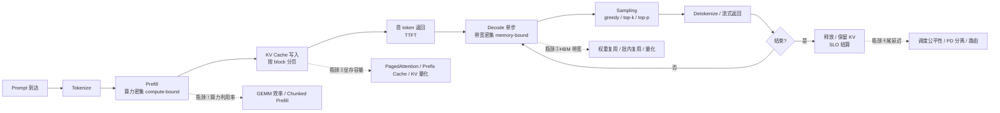
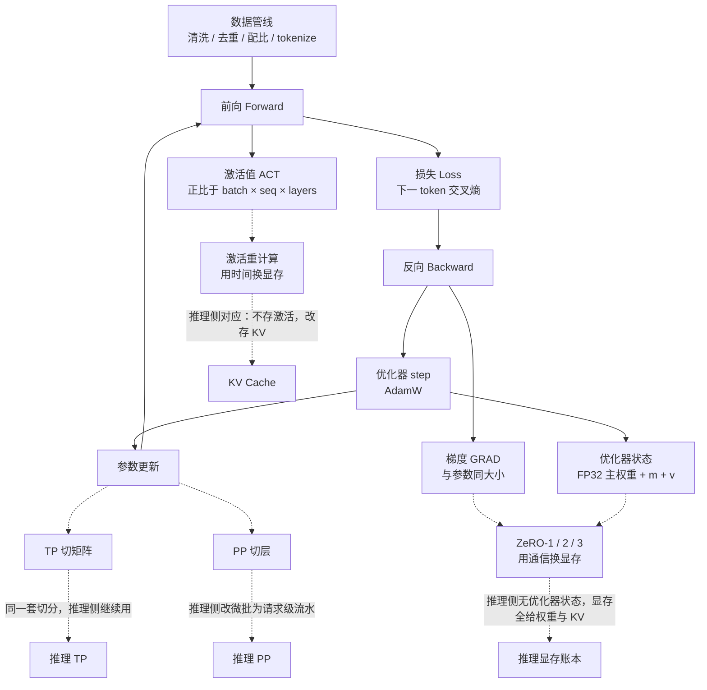

# mermaid 图改版前的原始代码（备份，可直接粘贴回原文还原）

> 生成时间 2026-11-15 · 三张图的原版都在这里。改版后的版本见 AI-Infra-学习手册与路线图.md。
> 原版问题：宽度分别是 3304 / 5440 / 1076 px，在 Obsidian 700px 正文栏里被等比压缩到 0.21× / 0.13× / 0.65×，字号只剩 3.4 / 2.1 / 10.4 px。

## 2.1 图 A：推理生命周期主链（原版）

## 2.2 图 A′：推理知识地图（原版）

```mermaid
flowchart TB
    ROOT["大模型推理系统"]

    ROOT --> L1["① 负载层<br/>请求长什么样"]
    ROOT --> L2["② 内存层<br/>状态放在哪里"]
    ROOT --> L3["③ 执行层<br/>算子怎么算得快"]
    ROOT --> L4["④ 分布层<br/>多卡多机怎么协作"]

    L1 --> L1a["Prefill / Decode 两阶段"]
    L1 --> L1b["TTFT / TPOT / 吞吐 / goodput"]
    L1 --> L1c["请求到达分布与 SLO"]
    L1 --> L1d["多轮 / Agent / 长上下文负载"]

    L2 --> L2a["KV Cache 容量账本"]
    L2 --> L2b["PagedAttention 分页管理"]
    L2 --> L2c["Prefix Cache / RadixAttention"]
    L2 --> L2d["KV 量化 / 驱逐 / 卸载"]
    L2 --> L2e["权重量化 W8A8 / INT4 / FP8"]

    L3 --> L3a["Continuous Batching"]
    L3 --> L3b["Chunked Prefill 与 Token Budget"]
    L3 --> L3c["抢占 / 换出 / 重算"]
    L3 --> L3d["算子融合 / CUDA Graph"]
    L3 --> L3e["FlashAttention / Decode Attention"]
    L3 --> L3f["投机解码与 MTP"]

    L4 --> L4a["TP 张量并行"]
    L4 --> L4b["PP 流水并行"]
    L4 --> L4c["EP 专家并行 All-to-All"]
    L4 --> L4d["PD 分离与 KV 传输"]
    L4 --> L4e["路由 / 负载均衡 / 容量规划"]
```

## 2.3 图 B：训练框架树（原版）

